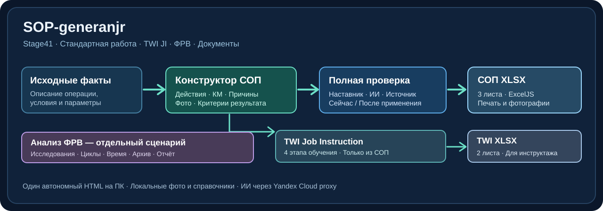
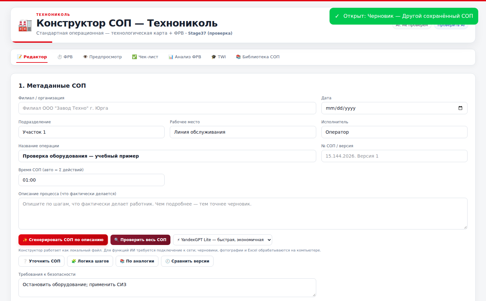
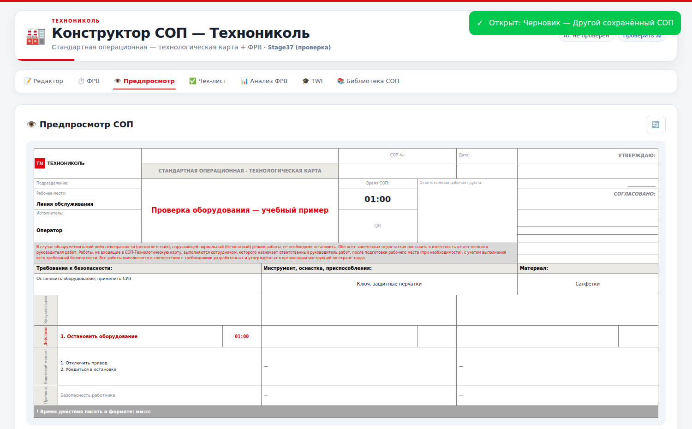
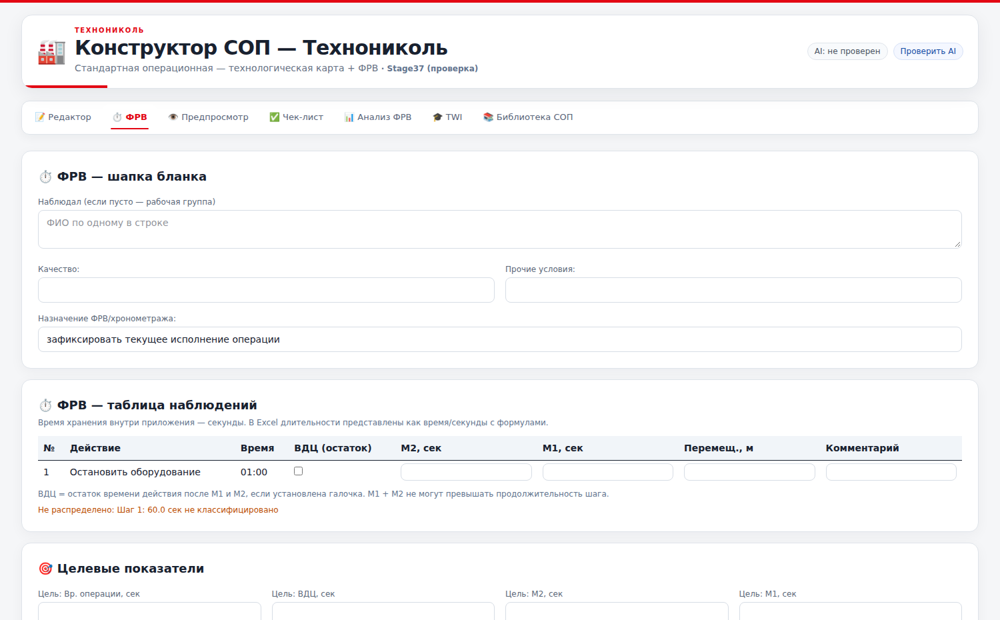
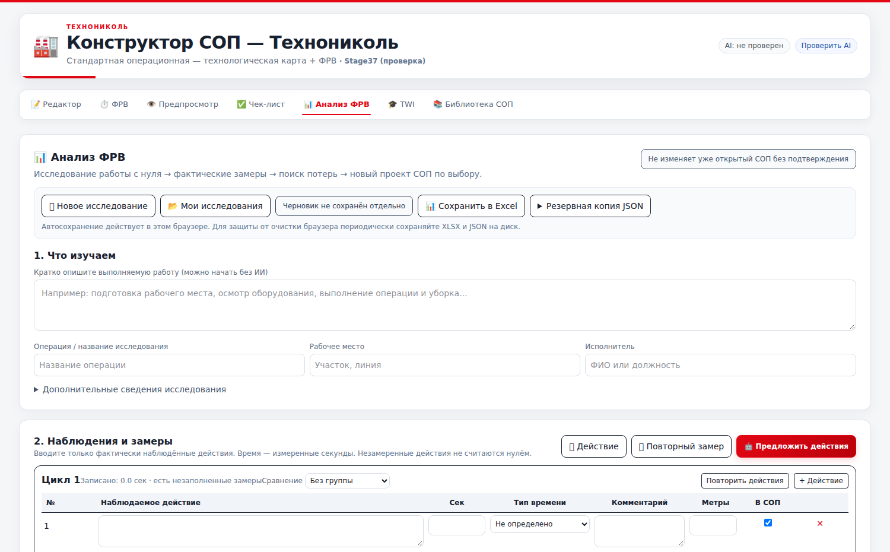
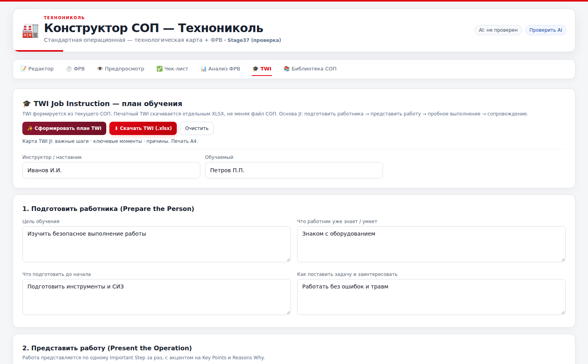
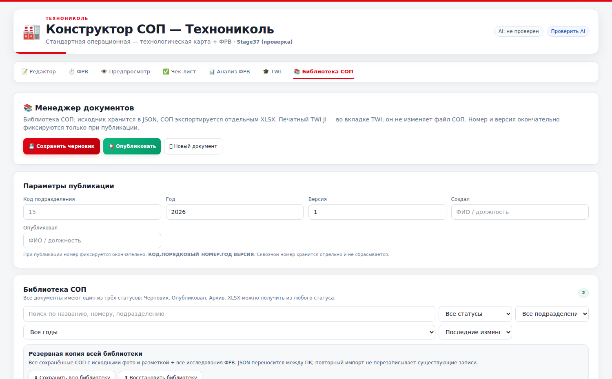
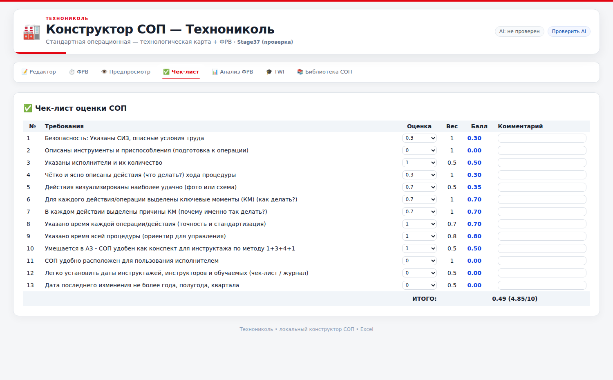

# SOP-generanjr — Конструктор СОП, TWI и анализ ФРВ

**Актуальная принятая версия: Stage43 · 25 ноября 2026 года**

Приложение для подготовки и проверки **стандартных операционных процедур (СОП)**, создания **TWI Job Instruction**, работы с **ФРВ**, фотографиями и печатными Excel-документами. Предназначено для **ПК** и открывается как **один автономный HTML-файл** в Chrome или Edge. Для основной работы не нужен локальный сервер или установка программы. ИИ-функции требуют доступа к настроенному прокси Yandex Cloud.

[**⬇ Скачать принятую Stage43 (.html)**](releases/stage43-sop-print-formats-20261125.html) · [Экспорт СОП в двух форматах](docs/STAGE43_SOP_PRINT_FORMATS_RU.md) · [Мастер импорта XLSX — руководство Stage42](docs/STAGE42_XLSX_IMPORT_WIZARD_RU.md) · [Полное руководство редактора СОП](docs/USER_GUIDE_STAGE41_RU.md) · [Актуальный статус проекта](docs/START_NEW_CHAT_RU.md)

**Статус версии:** Stage43 принята пользователем («работает») 25.11.2026 и объединена в `main` ([PR #41](https://github.com/shonentez-afk/SOP-generanjr/pull/41)). [Linux / Windows / Publish — SUCCESS](https://github.com/shonentez-afk/SOP-generanjr/actions/runs/45565635807), **127/127 модульных тестов на каждой ОС и четыре сценария Chrome на каждой ОС**. Экспорт СОП XLSX: книжный A3 (3 действия) или альбомный A3 (4 действия); предпросмотр остаётся книжным по решению пользователя. Stage42 сохранена как предыдущая принятая версия.

## Руководства пользователя — актуальная Stage43 и унаследованные функции

| Документ | Содержание |
|---|---|
| **[Два формата экспорта СОП — Stage43](docs/STAGE43_SOP_PRINT_FORMATS_RU.md)** | Книжная и альбомная выгрузка XLSX, без изменения предпросмотра |
| **[Мастер импорта готовых СОП — Stage42](docs/STAGE42_XLSX_IMPORT_WIZARD_RU.md)** | Пошаговый импорт корпоративских XLSX, предпросмотр ячеек, выбор рабочего листа, сопоставление действий/КМ/причин и фотографий, загрузка в штатный редактор, защита данных и известные ограничения |
| **[Полное руководство Конструктора СОП (основа Stage41)](docs/USER_GUIDE_STAGE41_RU.md)** | Пошаговая работа с СОП, КМ, причинами, ИИ, проверкой, TWI, ФРВ, фото, библиотекой, версиями и XLSX; настоящие учебные скриншоты Chrome |
| **[Как пользоваться аудитом первого уровня (L1)](docs/AUDIT_LEVEL1_USER_GUIDE_STAGE41_RU.md)** | Шесть проверяемых функциональных контуров, работа с доказательствами и рисками, контрольные сценарии, форма протокола |
| **[Руководство по единой интерактивной карте](docs/INTERACTIVE_MAP_USER_GUIDE_STAGE41_RU.md)** | Четыре вкладки, 16 задач ИИ, поиск 73 модулей, фильтры AST, 367 связей, восемь представлений LikeC4 |

**Исходные материалы:** [готовый аудит L1](docs/AUDIT_LEVEL1_STAGE41_RU.md) и [единая карта Stage41 из документационного PR #37](https://github.com/shonentez-afk/SOP-generanjr/raw/refs/heads/docs/archify-stage39-architecture-20261123/docs/diagrams/sop-stage41-unified.html). Карта **не входит в main по решению пользователя**; сам конструктор Stage43 принят.

## Быстрый старт

1. Скачайте [stage42-import-wizard-20261125.html](releases/stage42-import-wizard-20261125.html) и откройте файл двойным щелчком в актуальном **Chrome/Edge на ПК**.
2. Укажите название операции, условия, инструменты и описание процесса. Создайте шаги вручную, воспользуйтесь **«Сгенерировать СОП по описанию»** или нажмите **«📂 Импорт XLSX»** для загрузки готовой СОП через мастер с предпросмотром.
3. Проверьте **Действия → Ключевые моменты (КМ) → Причины (WHY)** и критерии результата; при необходимости добавьте фотографии и разметку.
4. Используйте существующий блок **«Полная проверка СОП»** для замечаний и применимых предложений. Создайте **TWI из СОП**, если нужен план обучения.
5. Сохраните черновик в библиотеку и выгрузите печатные **СОП XLSX / TWI XLSX**. Для переноса на другой компьютер сохраните отдельную резервную **JSON-копию библиотеки**.

> **Данные:** черновики и изображения хранятся в локальном хранилище браузера. Автосохранение не заменяет резервную JSON-копию. Другая папка запуска, браузер или ПК могут использовать другое локальное хранилище. Не включайте реальные производственные данные и ключи доступа в GitHub.

## Основные возможности

| Раздел | Возможности |
|---|---|
| **Импорт готовых СОП — Stage42** | Полноэкранный мастер XLSX: выбор правильного рабочего листа, исходные ячейки рядом с распознанными шагами, восстановление нумерованных КМ (в том числе более трёх и с переносами), просмотр и привязка фотографий, защита от случайной замены текущей СОП, заполнение всех штатных полей редактора с последующим сохранением в библиотеку. |
| **Конструктор СОП** | Ручные шаги и генерация из описания; действие, КМ, причины WHY, длительность, критерии результата, условия, материалы и фотографии. Без обязательных трёх КМ в каждом шаге. |
| **ИИ «Причина» ✨** | Уточнение технологического смысла ключевого момента. Проверенный ответ сразу попадает в поле **без окна «Было → Стало»**. Защита от неподтверждённых нормативов, чисел и последствий; ошибочный ответ не перезаписывает текст. |
| **Одно поле причин** | Одна общая причина или несколько строк **1., 2., 3.** внутри единственного корпоративного поля; экспорт XLSX не создаёт отдельных колонок для причин. |
| **Полная проверка / Наставник** | Локальные проверки и ИИ-замечания с привязкой к полям СОП. Для допустимых исправлений — сравнение **«Сейчас / После применения»** прямо в существующей карточке и прежняя кнопка **«Применить»**. Устаревшие предложения не перезаписывают ручные изменения. |
| **TWI Job Instruction** | План обучения по четырём этапам **Prepare → Present → Try Out → Follow Up** формируется **из текущего СОП**; возможны последующие ручные уточнения. TWI не является отдельным конструктором с нуля. |
| **ФРВ в СОП и независимый Анализ ФРВ** | Учёт времени и наблюдений; самостоятельные исследования, циклы, категории, анализ, библиотека и сохранение результатов. Связка **ФРВ → СОП → TWI** не обязательна. |
| **Фото и безопасность** | Фотографии к шагам, разметка, масштаб и история правок; встроенные локальные знаки **ISO 7010**, без скачивания значков из интернета. |
| **Библиотека и версии** | Черновики, опубликованные/архивные документы, защита от случайной потери изменений, переносимая JSON-копия с сохранёнными фотографиями и данными исследований. |
| **Excel для печати** | СОП — корпоративская книга **на 3 листах**; TWI — **на 2 листах**. ExcelJS включён в автономный HTML, изображения экспортируются в документ. |

**История улучшений Stage41:** дополнительные проверки смысла запросов ИИ при создании СОП, общей проверке и подготовке TWI; удаление только точных дубликатов подтверждённых предложений, без потери разных замечаний. Принятая логика кнопки ✨ «Причина» и интерфейс Stage40 сохранены. Реальные ответы YandexGPT по-прежнему требуют технологической оценки специалистом.

## Скриншоты интерфейса

Это **реальные снимки Chrome с учебными, непроизводственными данными**. Снимки сделаны во время приёмки **Stage37**; показанные разделы сохранены в Stage41. В актуальной сборке подпись версии, работа ✨ «Причина» и карточки полной проверки уже обновлены в Stage39.1–Stage41.

| Редактор СОП | Предпросмотр и печатное представление |
|---|---|
|  |  |
| Шаги, причины, фотографии, создание и уточнение СОП. | Просмотр документа перед выгрузкой и проверкой. |

| ФРВ текущего СОП | Самостоятельный анализ ФРВ |
|---|---|
|  |  |
| Измерения и наблюдения по шагам текущего документа. | Отдельные исследования, аналитика и перенос результатов по решению пользователя. |

| План обучения TWI | Библиотека документов |
|---|---|
|  |  |
| Четыре этапа обучения на основании действующего СОП. | Сохранение, открытие, архивирование и переносимые резервные копии. |

**Контрольный лист и проверки:** 

**Актуальная инструкция по импорту:** [мастер Stage42](docs/STAGE42_XLSX_IMPORT_WIZARD_RU.md). **Основные функции редактора:** [подробное руководство Stage41](docs/USER_GUIDE_STAGE41_RU.md). [Историческое руководство Stage37](docs/USER_GUIDE_STAGE37_RU.md) сохранено для происхождения скриншотов. Для изменений ИИ используйте [описание Stage41](docs/STAGE41_AI_QUALITY_RU.md).

## Единая карта и аудит первого уровня

### 🗺️ Единая интерактивная карта Stage41

[**Открыть / скачать единую карту Stage41 (HTML)**](https://github.com/shonentez-afk/SOP-generanjr/raw/refs/heads/docs/archify-stage39-architecture-20261123/docs/diagrams/sop-stage41-unified.html) · [Исходник карты и связанная документация](https://github.com/shonentez-afk/SOP-generanjr/tree/docs/archify-stage39-architecture-20261123/docs/diagrams)

**[Пошаговое руководство по карте](docs/INTERACTIVE_MAP_USER_GUIDE_STAGE41_RU.md)** — вкладки, 16 групп ИИ, фильтры, связи и восемь уровней LikeC4.

**Что внутри:** четыре взаимосвязанных представления: общая архитектура приложения; **16 групп ИИ-задач** (включая историческую); зависимости **73 модулей** и **367 межфайловых связей** с AST-свидетельствами; каталог **8 уровней LikeC4**. Можно искать модули, изучать вызовы и переходить к исходникам. Это карта разработки и анализа, а **не пользовательская функция конструктора**.

**Статус:** карта подготовлена в отдельном **[документационном PR #37](https://github.com/shonentez-afk/SOP-generanjr/pull/37)**, который пока не объединён с main. По данным PR, автономная карта прошла Chrome-проверки. Статические связи — не гарантия вызова кода во время выполнения; часть рёбер обозначена как неопределённая.

### 🔎 Аудит первого уровня (L1)

[**Открыть обзорный аудит первого уровня Stage41**](docs/AUDIT_LEVEL1_STAGE41_RU.md)

**[Как проводить и читать аудит L1](docs/AUDIT_LEVEL1_USER_GUIDE_STAGE41_RU.md)** — шесть контуров, доказательства, риски и протокол проверки.

Это начальная **функционально-архитектурная проверка**: что реализовано, какие подсистемы подтверждены автоматической регрессией, где проходит граница данных и какие проверки **не завершены** (реальный прокси, корпоративная сеть и прочее). В нём отдельно отмечены доказательства, ограничения, риски и ссылки на расширенные отчёты.

Для глубокой архитектурной трассировки: [подробный аудит Stage41 (CodeFlow / AST / GitNexus / LikeC4)](https://github.com/shonentez-afk/SOP-generanjr/blob/docs/archify-stage39-architecture-20261123/docs/diagrams/STAGE41_ARCHITECTURE_AUDIT_RU.md) из PR #37.

## Архитектура и разработка

- **Один автономный HTML** для пользователя; внутри репозитория исходники разделены на **73 JavaScript-модуля**. [Манифест Stage41](src/app/stage41-parts.json).
- **Воспроизводимая сборка:** [tools/build_stage41.py](tools/build_stage41.py); команда: <code>python tools/build_stage41.py --verify-static</code>. Сборщик доказывает, что принятой Stage40 добавлен только модуль качества Stage41.
- **ИИ:** Yandex Cloud Functions proxy; настраиваемые варианты YandexGPT. Встроенные модели не работают офлайн без доступа к прокси. Не помещайте ключи в код или README.
- **Локальные ресурсы:** ExcelJS, пиктограммы ISO 7010 и интерфейс включены в поставляемый файл; фотографии и черновики хранятся локально.
- **Тестирование:** [118 модульных тестов и Chrome Linux/Windows](https://github.com/shonentez-afk/SOP-generanjr/actions/runs/45150882096). Тестирование с имитацией ответов ИИ не доказывает точность каждого реального ответа YandexGPT.
- **Сопровождение:** [файл передачи новому чату](docs/START_NEW_CHAT_RU.md), [отчёт Stage41](docs/STAGE41_AI_QUALITY_RU.md), [журнал изменений](docs/CHANGELOG_RU.md), [исходники](src/modules/), [проверки](qa/).

## Границы проекта

Разработка ориентирована на **настольный браузер**, а не на телефон. Видеоанализ и хронометраж кнопками не предусмотрены. Excel — формат печати/отчёта, а не источник измерений ФРВ. Совместная работа через корпоративскую сетевую папку на двух физических ПК и физическая печать в конкретной корпоративной среде требуют отдельной проверки.

**Правило релизов:** рабочая версия хранится в <code>main</code>; новые функции разрабатываются отдельно и принимаются после регрессионных тестов и пользовательской проверки. Исторические HTML-файлы находятся в [releases/](releases/).
