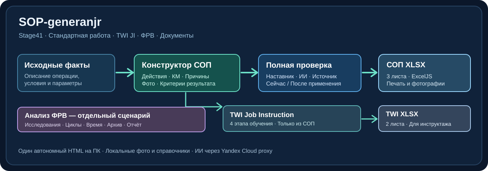

# Аудит первого уровня (L1) — SOP-generanjr, Stage41

**Дата:** 23.11.2026  
**Статус:** обзорный аудит **принятой** пользователем Stage41 в main.  
**Назначение:** дать проверяемое описание функциональных границ, ключевых пользовательских сценариев, известных рисков и дальнейших проверок. Это **не** сертификационный аудит безопасности, независимое тестирование реального цеха и не полный динамический анализ кода.

[← README](../README.md) · [**Как проводить аудит L1**](AUDIT_LEVEL1_USER_GUIDE_STAGE41_RU.md) · [Руководство SOP](USER_GUIDE_STAGE41_RU.md) · [Руководство по карте](INTERACTIVE_MAP_USER_GUIDE_STAGE41_RU.md) · [Скачать Stage41](../releases/stage41-ai-quality-20261123.html) · [Полная архитектурная карта Stage41 (PR #37)](https://github.com/shonentez-afk/SOP-generanjr/raw/refs/heads/docs/archify-stage39-architecture-20261123/docs/diagrams/sop-stage41-unified.html)

> **Как пользоваться отчётом:** документ ниже фиксирует результаты L1 и их границы. Для самостоятельного повторения проверки в браузере откройте [пошаговую инструкцию](AUDIT_LEVEL1_USER_GUIDE_STAGE41_RU.md); аудит L1 не является кнопкой приложения.

## 1. Предмет проверки

На первом уровне оцениваются шесть контуров: **пользователь → СОП → TWI → экспорт**, **ФРВ**, **ИИ и проверка**, **фото и локальные справочники**, **библиотека/резервирование**, **архитектура/сборка**. Цель — определить наличие подтверждённых защитных механизмов и открытых условий; для поиска алгоритмической ошибки конкретного модуля нужен следующий уровень исследования.

Проверка составлена по принятым GitHub-артефактам Stage37–Stage41, сценариям Chrome и отчётам CI. Результат не утверждает, что каждый из реальных производственных сценариев был проверен на предприятии.

## 2. Краткая карта системы

Рабочий маршрут **создания СОП**: исходное описание и ручные факты → шаги (Important Step / Key Point / Reason Why) → единая проверка → корпоративский XLSX. **TWI** формируется из существующего СОП; не требует предварительного анализа ФРВ. **Анализ ФРВ** может существовать самостоятельно и только по выбору пользователя передавать результаты в СОП.

## 3. Матрица доказательств L1

| Контур | Что проверено и реализовано | Доказательство | Ограничение |
|---|---|---|---|
| **Запуск и интерфейс** | Один автономный HTML работает в Chrome/Edge на ПК; не требует отдельного сервера. Редактор, TWI, ФРВ, просмотр, чек-лист и библиотека. | [Stage37 Chrome-скриншоты](USER_GUIDE_STAGE37_RU.md), [Stage41 CI](https://github.com/shonentez-afk/SOP-generanjr/actions/runs/45150882096) | Не заявляется поддержка телефона. |
| **Создание СОП** | Ручное/ИИ-составление шагов, причины в одном поле с возможной нумерацией, отдельные критерии результата. | [Stage41 качество ИИ](STAGE41_AI_QUALITY_RU.md), наследованные Chrome-тесты Stage39.1 | Технологическую достоверность текста подтверждает инженер. |
| **Полная проверка / Наставник** | Вывод замечаний с проверенным источником; у допустимых исправлений сравнение «Сейчас / После применения» и защита старых предложений при ручной правке. | [Stage40 приёмка](STAGE40_INLINE_REVIEW_RU.md), [Stage41 CI](https://github.com/shonentez-afk/SOP-generanjr/actions/runs/45150882096) | Гипотеза ИИ не становится подтверждённым фактом автоматически. |
| **ИИ «Причина» ✨** | Прямое применение только после локальной проверки; отклонение пустых/служебных/недоказанных утверждений, защита опубликованного документа. | [Stage41 CI](https://github.com/shonentez-afk/SOP-generanjr/actions/runs/45150882096), [Stage39.1 отчёт](STAGE39_1_AI_REASON_FRV_RU.md) | Проверки не гарантируют правильность всех возможных формулировок. |
| **TWI Job Instruction** | Обучение в четыре этапа из текущего СОП; передача Steps/KM/WHY; печатный XLSX на двух листах. | [Настольное руководство](USER_GUIDE_STAGE37_RU.md), наследованные Stage39.1–Stage41 тесты | Проверить инструктаж на реальной операции и итоговую печать. |
| **ФРВ / Анализ ФРВ** | ФРВ внутри СОП и отдельное исследование, измерения, библиотека, аналитика и экспорт; сохранение исходных наблюдений при ИИ-операциях. | [Аудит Stage35](STAGE35_FRV_UX_FUNCTIONAL_AUDIT_RU.md), [Stage41 CI](https://github.com/shonentez-afk/SOP-generanjr/actions/runs/45150882096) | Измерения вводятся в приложении; нет видеоанализа, импорта чужих замеров и секундомера по кнопкам. |
| **Фото, иконки, Excel** | Встроенные локальные ISO 7010 и ExcelJS; редактор фотографий; фотографии проходят в XLSX; СОП содержит три листа. | [Stage37 Chrome](USER_GUIDE_STAGE37_RU.md), Windows ExcelJS/ISO/photo smoke Stage41 | Физическую печать на принтере конкретного цеха проверить отдельно. |
| **Данные / архив** | Локальные черновики, предупреждения о потере изменений, резервное копирование в переносимый JSON; архивные документы защищены. | [Stage37 аудит данных](STAGE37_DESKTOP_AUDIT_RU.md) | Хранилище зависит от браузера и пути к HTML; JSON-резервирование обязательно. |
| **Архитектура** | 73 исходных JS-модуля → один HTML; сборка Stage41 отличается от принятой Stage40 только добавленным модулем. | [Манифест](../src/app/stage41-parts.json), [проверка Stage41](https://github.com/shonentez-afk/SOP-generanjr/actions/runs/45150882096) | Общий JS runtime — не полностью изолированные независимые модули. |

**Вывод по автоматическим проверкам:** [Actions #45150882096](https://github.com/shonentez-afk/SOP-generanjr/actions/runs/45150882096) завершился с **Linux / Windows / Publish SUCCESS**, **118 модульными тестами**, Chrome-проверкой новой логики Stage41, а также регрессиями Stage39.1/40 и работы ФРВ/Excel/фото. Пользователь подтвердил новую версию сообщением «работает».

## 4. Установленные границы и риски

| Приоритет наблюдения | Открытый вопрос / риск | Что рекомендовано |
|---|---|---|
| **Высокий, эксплуатационный** | Локальное хранилище браузера может быть очищено; перенос HTML в другую папку или на другой ПК не переносит автоматически черновики и фотографии. | Делать переносимую JSON-копию библиотеки до крупных изменений и переноса на другой ПК; проверять восстановление. |
| **Высокий, технологический** | YandexGPT может сформулировать убедительную, но не подтверждённую технологическую причину или требование; проверки программы покрывают лишь часть классов ошибок. | Перед выпуском рабочего СОП выполнять производственную проверку причин, режимов, безопасности и параметров. |
| **Требует натурной проверки** | Корпоративский прокси, разрешения на сетевую папку, межкомпьютерные операции и принтеры отличаются от окружения CI. | Отдельная проверка в корпоративской сети и на реальном оборудовании, без предположений о готовности. |
| **Архитектурный** | Статические анализаторы могут предполагать вызовы, которые не происходят в runtime. В отчёте Stage41 оставлены **26 неоднозначных связей** Acorn AST. | Использовать интерактивную карту и выбирать связи для адресной трассировки, не считать граф полным доказательством исполнения. |
| **Документационный** | Полная архитектурная карта пока живёт в Draft PR #37 и не является частью main. | Открывать карту по ссылке ниже; после отдельной приёмки синхронизировать документацию с main. |

Здесь нет заявления, что новых дефектов P0/P1 не существует: обзор уровня L1 не заменяет детальные тесты конкретных пользовательских файлов.

## 5. Единая карта Stage41 и глубокий аудит

**[Единая интерактивная карта Stage41 — скачать HTML](https://github.com/shonentez-afk/SOP-generanjr/raw/refs/heads/docs/archify-stage39-architecture-20261123/docs/diagrams/sop-stage41-unified.html)** — 4 вкладки: архитектура, 16 групп ИИ-задач, граф **73 модулей / 367 межфайловых связей** и 8 схем LikeC4. Ссылки на исходники позволяют переходить к месту возможного изменения; фильтры AST показывают уровень уверенности в связи.

**[Полный Stage41 архитектурный отчёт](https://github.com/shonentez-afk/SOP-generanjr/blob/docs/archify-stage39-architecture-20261123/docs/diagrams/STAGE41_ARCHITECTURE_AUDIT_RU.md)** сравнивает CodeFlow, Acorn AST, GitNexus и LikeC4 и фиксирует их ограничения. Его результаты не являются оценкой качества пользовательских СОП или точности YandexGPT. Документация отдельно рассматривается в [PR #37](https://github.com/shonentez-afk/SOP-generanjr/pull/37); на дату составления он не объединён с main.

## 6. Решение L1 и дальнейший контроль

**Статус:** принятая программная версия Stage41 может использоваться как основа дальнейшей разработки. **Нельзя** на основании одного L1-обзора объявлять завершёнными реальную производственную приёмку, кибербезопасность, физическую печать или корпоративский сетевой сценарий.

Перед новыми изменениями: зафиксировать воспроизводимый пример проблемы, работать в отдельной ветке, сохранять Stage41 неизменной, запускать наследованные Chrome/Excel/ФРВ тесты и только затем проводить ручную приёмку.

[Сводка Stage41](STAGE41_AI_QUALITY_RU.md) · [Руководство с изображениями](USER_GUIDE_STAGE37_RU.md) · [Файл передачи новому чату](START_NEW_CHAT_RU.md)
