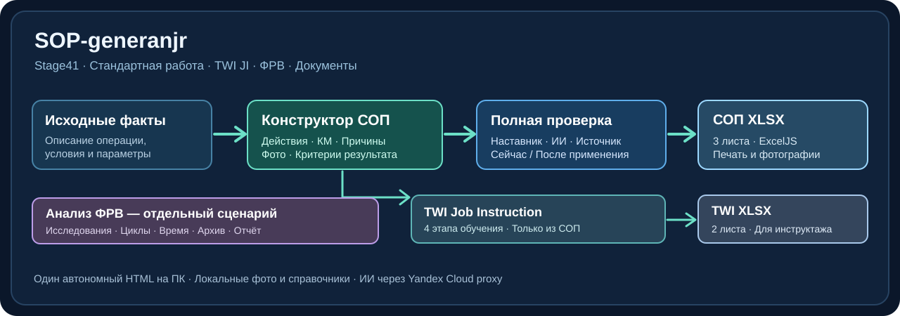
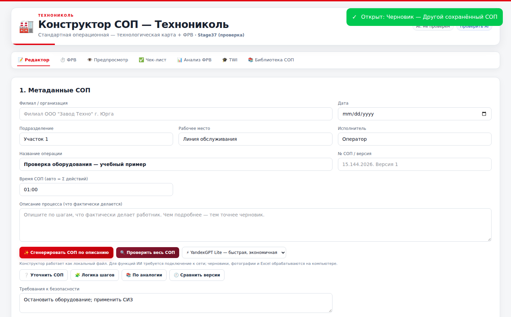
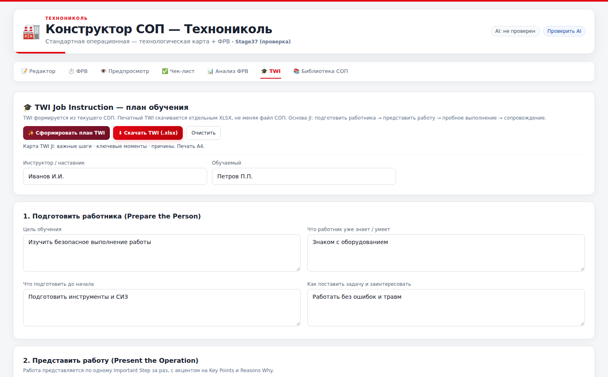
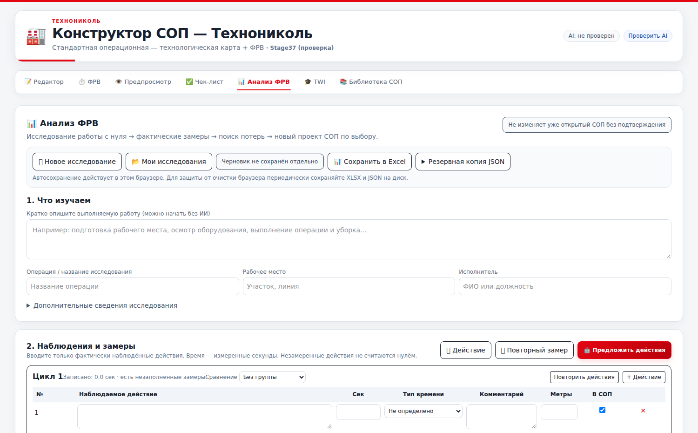

# Руководство по аудиту первого уровня (L1) — SOP-generanjr, Stage41

**Редакция:** 23.11.2026 · **Основа:** принятая пользователем Stage41 в `main`  
**Для кого:** владелец проекта, технолог, мастер, наставник, тестировщик, проверяющий процесс подготовки СОП.  
**Важное различие:** **аудит первого уровня (L1) — это документальная и функциональная процедура**, а **не кнопка** в приложении, не функция ИИ и не автоматический сертификат качества.

[← Главное README](../README.md) · [Основное руководство конструктора](USER_GUIDE_STAGE41_RU.md) · [Отчёт L1 с результатами](AUDIT_LEVEL1_STAGE41_RU.md) · [Интерактивная карта — руководство](INTERACTIVE_MAP_USER_GUIDE_STAGE41_RU.md)

## 1. Что такое L1 и зачем он нужен

**Первый уровень** нужен, чтобы быстро ответить на четыре вопроса:

1. **Что фактически реализовано?** Какие экраны, данные, функции создания, проверки и экспорта доступны в принятой версии.
2. **Чем это подтверждено?** Реальной пользовательской приёмкой, автоматическими тестами, скриншотами, кодом или только планом.
3. **Где границы и риски?** Какие функции зависят от YandexGPT, браузерного хранилища, корпоративской сети, принтера и решений технолога.
4. **Нужна ли углублённая проверка?** Какие вопросы следует направить на проверку модуля, данные на реальном ПК или исследование конкретного алгоритма.

L1 **не заменяет** комплексную проверку безопасности, аудит технологической документации предприятия, анализ кибербезопасности, натурную проверку всех принтеров и реальное измерение времени работы.

**Где смотреть готовый вывод:** [«Аудит первого уровня — Stage41»](AUDIT_LEVEL1_STAGE41_RU.md). Настоящий файл объясняет, **как им пользоваться и как повторить выборочную проверку**. Результат и методика — разные документы.

## 2. Перед началом проверки

Потребуются:

- Рабочий **ПК**, Chrome или Edge.
- [Принятая сборка Stage41](../releases/stage41-ai-quality-20261123.html) — именно этот HTML, а не более ранняя версия.
- [Отчёт L1 Stage41](AUDIT_LEVEL1_STAGE41_RU.md).
- [Руководство по конструктору Stage41](USER_GUIDE_STAGE41_RU.md) и скриншоты учебного примера Stage37.
- [GitHub Actions Stage41](https://github.com/shonentez-afk/SOP-generanjr/actions/runs/45150882096) — результаты ранее выполненных CI-проверок.
- Для дополнительной проверки зависимостей: [единая карта Stage41](https://github.com/shonentez-afk/SOP-generanjr/raw/refs/heads/docs/archify-stage39-architecture-20261123/docs/diagrams/sop-stage41-unified.html) из документационного Draft PR #37.

Используйте **обезличенный учебный процесс**. Не загружайте в общедоступный GitHub производственные СОП, ФРВ, фотографии сотрудников, коммерческие параметры или ключи API.

### Как зафиксировать точку отсчёта

В рабочем протоколе запишите:

| Пункт | Что зафиксировать |
|---|---|
| Версия | Stage41 |
| Источник | `main / releases/stage41-ai-quality-20261123.html` |
| Дата/исполнитель | Дата фактической проверки и ответственный |
| Среда | ОС, браузер, путь открытия HTML (`file://`) |
| Образец | Название учебной операции, а не конфиденциальный SOP |
| Внешние сервисы | «Прокси доступен / не проверялся», «Сетевая папка проверена / не проверялась» |
| Резервная копия | Куда сохранён JSON и удалось ли его прочитать |

Сразу разделяйте **«подтверждено ранее в CI»** и **«повторено сейчас в нашей среде»** — это разные доказательства.

## 3. Как читать основной отчёт L1

[Откройте отчёт первого уровня](AUDIT_LEVEL1_STAGE41_RU.md) и читайте его по порядку.

| Раздел отчёта | Что из него получить |
|---|---|
| **Предмет проверки** | Что охватывает L1 и чего он не обещает |
| **Краткая карта системы** | Схема, где проходят маршруты СОП, TWI, ФРВ и экспорта |
| **Матрица доказательств** | Что реализовано, ссылка на доказательство и явное ограничение |
| **Границы и риски** | Открытые проверки для эксплуатации, качества ИИ, хранения и архитектуры |
| **Единая карта и глубокий аудит** | Переход к модулям и статическим зависимостям для адресной проверки |
| **Решение L1** | Можно ли принять текущую базу для дальнейшей разработки, что остаётся за рамками |

**Не путайте результат проверки с уровнем уверенности:**

- **Проверено автоматически:** тесты действительно прошли на определённом наборе условий и примеров.
- **Принято пользователем:** пользователь подтвердил работоспособность своей сборки; это не гарантия всех будущих сценариев.
- **Подтверждено кодом:** в исходниках существует конкретный механизм; его наличие не доказывает, что он сработает для любого ввода.
- **Требует натурного испытания:** без доступа к корпоративному принтеру, реальной Cloud Function или сетевому диску заключение делать нельзя.
- **Предложение/гипотеза:** это не подтверждённый факт; должно быть обозначено отдельно.

## 4. Контуры L1 — что проверять

Аудит разделён на **шесть направлений**. Ниже практический порядок выборочной проверки; если у вас нет доступа к ИИ/сети/принтеру, помечайте пункт **«Не проверено»**, а не «Ошибок нет».

### Контур A. Редактор СОП, логика шагов и версия

1. Откройте Stage41 и убедитесь в подписи версии.
2. На учебном примере создайте два-три шага с действиями, КМ, WHY и критерием результата.
3. Проверьте изменение порядка, копирование и отображение шагов. Не воспринимайте операции с шагами как подтверждение смысла причины.
4. Запишите одну общую причину и несколько причин в единственном поле с нумерацией.
5. Сохраните черновик и откройте документ повторно, не предполагая автоматической синхронизации с другой папкой.

**Ожидаемый результат:** поля сохраняются без непреднамеренного размножения причин; нумерованные строки не создают новые Excel-колонки.

**Сведения в отчёте:** «Создание СОП» и «Запуск и интерфейс».

### Контур B. ИИ, наставник и безопасность применения

1. Если прокси доступен, создайте черновик по известному описанию. Сравните результат с исходными фактами.
2. Проверьте ✨ «Причина»: валидный ответ **применяется прямо в поле**, отдельного «Было → Стало» нет. Неудачный результат должен быть отклонён или требует исправления.
3. Выполните **«Полную проверку СОП»**. У допустимого замечания должны быть прежняя кнопка «Применить» и встроенное сравнение **«Сейчас / После применения»**.
4. Измените текст вручную **после проверки**, затем попробуйте применить старое предложение. Оно не должно перезаписать новое содержимое.
5. Убедитесь, что неподтверждённые параметры, нормативы и последствия не стали «достоверными фактами» только потому, что их написал ИИ.

**Ожидаемый результат:** у Stage41 меньше точных дублей доказанных исправлений; гипотезы и вопросы сохраняются. При этом невозможно гарантировать безошибочность каждого реального ответа YandexGPT.

**Граница:** CI проверяет имитацию ответов и браузерное поведение, не все реальные запросы в облако.

### Контур C. TWI и выгрузка документов

1. Сформируйте TWI **из текущего СОП**.
2. Проверьте четыре этапа JI и соответствие исходным Action / КМ / WHY.
3. Измените исходный СОП и проверьте предупреждение об актуальности TWI.
4. Создайте отдельные файлы: **СОП XLSX (3 листа)** и **TWI XLSX (2 листа)**.
5. Убедитесь, что исходные причины остаются в одной ячейке, текст читается, фото не подменено.

**Не делайте вывод о качестве бумажного экземпляра** только по браузерному тесту. Для конкретного принтера нужна физическая пробная печать.

### Контур D. ФРВ и наблюдения

1. Откройте ФРВ в СОП и проверьте существующие показатели шагов.
2. Откройте независимый **«Анализ ФРВ»** и создайте учебное исследование.
3. Внесите только фактически заданные длительности и при необходимости циклы.
4. Убедитесь, что незамеренные строки не записываются как нулевые измерения.
5. Просмотрите предложения анализа, сохраните исследование и попробуйте перенести выбранные данные в новый СОП, не заменяя исходный документ без вашего решения.

**Граница:** видео и хронометраж кнопками не являются частью этой версии.

### Контур E. Фотографии и локальные данные

1. Приложите учебную фотографию к шагу, сделайте разметку, сохраните документ.
2. Проверьте предпросмотр, открытие библиотеки и XLSX с фотографией.
3. Используйте встроенные ISO 7010; отсутствие интернета не должно требовать повторной загрузки значков.
4. Сделайте JSON-копию **всей библиотеки**, восстановите её в контролируемом тестовом окружении и сравните список документов и изображений.
5. Не проверяйте восстановление на единственной реальной копии данных без запасного архива.

**Граница:** перенос одного HTML-файла не переносит локальную IndexedDB и фотографии.

### Контур F. Архитектура, выпуск и регрессии

1. Откройте [манифест Stage41](../src/app/stage41-parts.json) — в нём **73 активных модуля**, порядок важен для сборки.
2. Посмотрите [GitHub Actions](https://github.com/shonentez-afk/SOP-generanjr/actions/runs/45150882096) — Linux, Windows и Publish завершились с **SUCCESS**, 118 модульных тестов.
3. При необходимости перейдите в [единую карту](https://github.com/shonentez-afk/SOP-generanjr/raw/refs/heads/docs/archify-stage39-architecture-20261123/docs/diagrams/sop-stage41-unified.html), найдите нужный модуль и его связи.
4. Для спорных связей проверяйте исходники по ссылкам на GitHub; статическое наличие идентификатора не является доказательством вызова в Chrome.

**Граница:** 73 файла **собираются в единый JS runtime**, а не в 73 полностью независимых сервиса.

## 5. Как записывать результаты

Для собственного аудита полезна простая шкала, без фиктивных процентов:

| Отметка | Когда ставить |
|---|---|
| **PASS** | Проверка выполнена и совпала с ожидаемым результатом |
| **FAIL** | Получен воспроизводимый неправильный результат с конкретными действиями |
| **Не проверено** | Нет нужного оборудования, прокси, тестовой среды или данных |
| **Нужно уточнить** | Есть неполное доказательство, неоднозначная логика или спорный результат |

**Шаблон одной записи:**

> Контур: B — Полная проверка СОП  
> Среда: Windows / Chrome / Stage41  
> Вход: учебный СОП, шаг 2, исправление WHY  
> Действия: проверить СОП → изменить причину вручную → применить старую рекомендацию  
> Ожидание: старая рекомендация не должна перезаписать новую причину  
> Факт: [заполнить после проверки]  
> Статус: PASS / FAIL / Не проверено / Нужно уточнить  
> Доказательство: скриншот, журнал, ссылка на коммит/тест, обезличенные данные  
> Следующее действие: [конкретное решение]

**При дефекте** сохраняйте исходный текст и последовательность действий, но перед публикацией в открытом репозитории удаляйте производственные и персональные сведения.

## 6. Как присвоить приоритет проблеме

Это **рекомендуемая схема разбора**, а не автоматически вычисляемые программой уровни:

| Приоритет | Пример |
|---|---|
| **Критично** | Потеря/незаметная подмена пользовательских СОП, фотографий или фактических измерений; запись в защищённый опубликованный документ |
| **Высокий** | Некорректный производственный параметр в документе без предупреждения; неверное содержание печатного СОП или TWI |
| **Средний** | Неудобная последовательность действий, неоднозначные замечания, нарушение удобства просмотра или частичная потеря форматирования |
| **Низкий** | Подсказки, декоративное оформление и уточнения документации, не влияющие на данные |

**Предупреждение:** вред для безопасности людей оценивается специалистами предприятия, а не только этой классификацией.

## 7. Как работать с техническими доказательствами

В существующем архитектурном исследовании Stage41 применялись разные инструменты:

- **CodeFlow:** **367 межфайловых связей** в одном статическом графе.
- **Acorn AST:** из них **324** имеют признаки прямых вызовов, **17** — ссылки на функции, **26** оставлены неопределёнными.
- **GitNexus:** **2 279 узлов и 7 956 связей** своего графа сущностей; эти числа нельзя напрямую сравнивать с CodeFlow.
- **LikeC4:** **8 архитектурных представлений**; внешний многофайловый сайт собирался отдельно.
- **Archify:** JSON модели существуют, но официальный `finalize` ещё не подтверждён.

**Это сведения из документационного PR #37, а не новые тесты вашего ПК.** Часть навигации официального LikeC4 ещё требует проверки. Подробные источники: [архитектурный аудит Stage41](https://github.com/shonentez-afk/SOP-generanjr/blob/docs/archify-stage39-architecture-20261123/docs/diagrams/STAGE41_ARCHITECTURE_AUDIT_RU.md) и [руководство по карте](INTERACTIVE_MAP_USER_GUIDE_STAGE41_RU.md).

## 8. Что именно НЕ подтверждено принятым L1

- Работа внешнего YandexGPT **для всех типов реальных операций** и достоверность всех его причин/нормативов.
- Физическая печать и её соответствие конкретному принтеру и корпоративному утверждённому бланку.
- Многопользовательская работа через сетевую папку **между двумя физическими ПК** в корпоративной сети.
- Устойчивость к удалению браузерного хранилища **без резервной копии**.
- Полное динамическое покрытие всех исходных 73 модулей и всех возможных событий UI.
- Автоматические переходы между **всеми восемью** видами официального сайта LikeC4: его Chrome smoke не подтвердил такие переходы.

Отсутствие подтверждения — **не доказательство неисправности**. Для заключения нужны отдельные испытания.

## 9. Как завершить аудит первого уровня

1. Заполните матрицу результатов по контурам A–F, включая «Не проверено».
2. Для **FAIL** приложите воспроизводимые действия и сохраните не конфиденциальный пример.
3. Для открытых пунктов назначьте ответственное лицо и способ проверки (на реальном ПК, прокси, принтере, по исходникам).
4. Сохраните копию протокола и сделайте резервную JSON-копию библиотеки, если исследование меняло данные.
5. Передайте разработчику **конкретный дефект с фактом**, а не общий запрос «перепроверить всё».

**Главный вывод:** Stage41 — принятая база для дальнейшей разработки, но статус **«L1 PASS»** можно присваивать лишь тем сценариям, которые действительно проверены в вашей среде. Остальные должны остаться в открытых пунктах.

---

### Связанные материалы

- [Основной отчёт L1 Stage41](AUDIT_LEVEL1_STAGE41_RU.md) — какие доказательства уже собраны.
- [Полное руководство Конструктора СОП Stage41](USER_GUIDE_STAGE41_RU.md) — как пользоваться экранами и сохранять работу.
- [Руководство по единой интерактивной карте](INTERACTIVE_MAP_USER_GUIDE_STAGE41_RU.md) — как исследовать архитектуру, зависимости и ИИ.
- [GitHub Actions Stage41](https://github.com/shonentez-afk/SOP-generanjr/actions/runs/45150882096).
- [Файл передачи новому чату](START_NEW_CHAT_RU.md).
