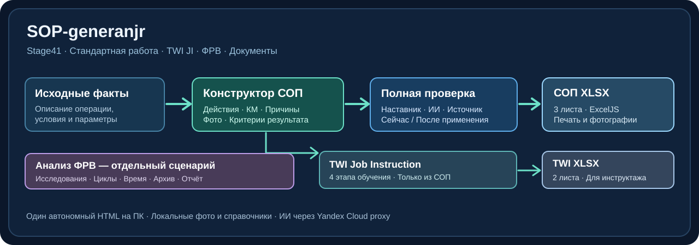

# Руководство по единой интерактивной карте SOP-generanjr — Stage41

**Редакция:** 23.11.2026 · **Снимок архитектуры:** принятая Stage41, **73 JavaScript-модуля**  
**Для кого:** владелец проекта, разработчик, инженер, проверяющий зависимости ИИ/СОП/TWI/ФРВ.  
**Формат:** автономная интерактивная архитектурная **карта HTML**, не сама программа SOP-generanjr.

[← Главная README](../README.md) · [Руководство пользователя СОП](USER_GUIDE_STAGE41_RU.md) · [Руководство по аудиту L1](AUDIT_LEVEL1_USER_GUIDE_STAGE41_RU.md)

**[⬇ Скачать единую карту Stage41 (.html)](https://github.com/shonentez-afk/SOP-generanjr/raw/refs/heads/docs/archify-stage39-architecture-20261123/docs/diagrams/sop-stage41-unified.html)**

[Просмотреть исходник карты в GitHub](https://github.com/shonentez-afk/SOP-generanjr/blob/docs/archify-stage39-architecture-20261123/docs/diagrams/sop-stage41-unified.html) · [Подробный аудит архитектуры](https://github.com/shonentez-afk/SOP-generanjr/blob/docs/archify-stage39-architecture-20261123/docs/diagrams/STAGE41_ARCHITECTURE_AUDIT_RU.md) · [Документационный PR #37](https://github.com/shonentez-afk/SOP-generanjr/pull/37)

> **Статус на момент написания:** интерактивная карта находится в отдельном **Draft PR #37**, не в `main`. Она описывает **код принятой Stage41**, но само размещение карты в документационной ветке **не означает**, что содержимое PR уже принято и объединено с основной веткой. Реальная программа скачивается [отдельно](../releases/stage41-ai-quality-20261123.html).

## 1. Что показывает карта и когда её открывать

Карта помогает ответить на вопросы: **из каких частей состоит программа**, какие запросы ИИ она формирует, **какой модуль вызывает другой**, какие исходники изменятся при исправлении, и как устроены крупные контуры СОП/TWI/ФРВ.

Это инструмент **изучения проекта**, не редактор СОП, не экран пользователя и не журнал реальных облачных запросов.

Карта включает четыре вкладки:

| Вкладка (реальное название в HTML) | Для чего нужна |
|---|---|
| **Общая архитектура** | 17 компонентов и 23 логические связи, пользователи/браузер/СОП/ИИ/ФРВ/хранение/Excel |
| **Запросы и ответы ИИ** | 16 групп задач, контекст, параметры, ожидаемый ответ, проверки и ссылки на код |
| **Зависимости 73 модулей** | 367 межфайловых связей, входящие/исходящие, имена функций, строки и оценка доказательств AST |
| **LikeC4 · 8 уровней** | Каталог восьми тематических видов архитектуры, быстрый переход к соответствующему обзорному представлению, ссылки на модель LikeC4 |

## 2. Как открыть карту

1. Нажмите **«Скачать единую карту Stage41»** выше или откройте её страницу на GitHub и выберите сохранение исходного HTML.
2. Сохраните файл `sop-stage41-unified.html` на ПК.
3. Откройте файл в актуальном **Chrome / Edge** двойным щелчком. В адресной строке должен быть путь с `file://`.
4. В шапке найдите название **«Единая карта SOP-generanjr»**, отметку Stage41 и **четыре вкладки навигации**.
5. Начните с **«Общая архитектура»**. Для перехода в другое представление нажимайте верхние вкладки — не нужно открывать отдельные HTML-файлы.

**Важно:** сам единый HTML содержит основные схемы и данные и не требует локального сервера. Однако ссылки на **реальные исходники GitHub** требуют сети. Отдельный **официальный сайт LikeC4** — многокомпонентный и при самостоятельном запуске требует локальный HTTP-сервер; это не то же самое, что единая карта.

## 3. Вкладка «Общая архитектура»

На схеме находятся функциональные блоки от сотрудника и автономного HTML до СОП, TWI, анализа ФРВ, хранилища, Yandex Cloud и выгрузки Excel.

### Управление

| Элемент | Что делать |
|---|---|
| **«Поиск по компонентам…»** | Введите, например, «TWI», «ФРВ», «Yandex», «Библиотека» |
| **«Все связи»** | Отобразить полный набор логических связей обзора |
| **«Основные потоки»** | Сосредоточиться на ключевых маршрутах и скрыть второстепенные связи |
| **«Сброс выбора»** | Снять выделение компонентов |
| **«Печать / PDF»** | Перейти к печати страницы средствами браузера |
| **Карточка компонента** | Нажмите на блок, чтобы выделить его связи и прочитать объяснение в боковой панели |

**Пример 1 — путь готового СОП:**

Сотрудник → автономный HTML → **«Конструктор СОП»** → **«Контроль качества»** → **«Экспорт СОП XLSX»**.

При выборе компонента боковая панель раскрывает назначение блока и ссылки на исходники. Схема отражает архитектурные границы, а **не автоматическое доказательство, что конкретная функция вызвалась во время вашего клика**.

**Пример 2 — откуда берётся ответ ИИ:**

**«ИИ-помощник»** → **«Yandex Cloud Function»** → **«YandexGPT API»** → ответ модели → локальная проверка → возможное применение к СОП.

В карте не хранятся ваши реальные производственные запросы и ответы. Это построенная по исходникам схема, а не перехват сетевого трафика.

**Пример 3 — где сохраняются фотографии:** найдите **«Фотографии и разметка»**, **«IndexedDB: медиа»** и **«Библиотека документов»**. Различайте локальное браузерное хранение и опциональную **«Сетевую папку»** — последняя не признана проверенной для двух физических ПК.

## 4. Вкладка «Запросы и ответы ИИ»

Нажмите **«Запросы и ответы ИИ»**. Здесь справа показывается выбранная задача, а слева находятся **«Найти запрос, поле, ответ…»**, категории и список задач.

### Как найти и изучить запрос

1. Выберите категорию: **СОП**, **Контроль**, **TWI**, **ФРВ** или **Сервис**.
2. Найдите задачу поиском или прокруткой списка.
3. Нажмите название задачи. В правой части появятся её назначение, входные сведения, параметры, формат ответа, ограничения и связанные исходные файлы.
4. Посмотрите, **какое поле СОП или ФРВ** действительно передаётся и какие значения ответа могут быть записаны после проверки.
5. При необходимости нажмите **«Копировать»** у примера данных; это копирование схемы/фрагмента для анализа, **не отправка нового запроса YandexGPT**.
6. Ссылки **«Исходные файлы»** открывают GitHub, где можно проверить реальную реализацию.

### Основные группы AI task

| Задача в карте | Что делает |
|---|---|
| `generate_sop` | Генерация шагов СОП из описания |
| `stage27_analog` | Проект СОП по выбранному аналогу |
| `edit_<type>` | ✨ улучшение отдельного поля, в том числе причины |
| `photo_hint` | Подсказка для будущего снимка |
| `review` | Полная или частичная проверка СОП |
| `dispute` | Обсуждение и оспаривание замечания наставника |
| `stage27_questions` | Вопросы для уточнения фактов |
| `stage27_proposals` | Исправления по подтверждённым ответам |
| `stage27_explain` | Пояснение конкретного замечания |
| `twi_generate` | План обучения на основании текущего СОП |
| `frv_study_build` | Предварительный список действий для исследования ФРВ |
| `frv_study_row_suggest` | Подсказка по одной строке исследования |
| `frv_study_analyze` | Анализ потерь и предложений по ФРВ |
| `frv_study_classify` | Классификация измеренных действий |
| `healthcheck` | Проверка соединения с ИИ |
| `stage27_mentor` | **Историческая реализация**, которая **не вызывается штатным UI** |

**Почему 16 групп:** описано пятнадцать доступных групп/семейств и одна отдельная неиспользуемая в обычном интерфейсе реализация `stage27_mentor`. Не путайте её с единой задачей `review`, которой пользуется актуальная полная проверка.

### Разбор запроса «Причина»

1. Найдите `edit_<type>` и в описании уточните режим `edit_reason`.
2. Посмотрите контекст: действие, ключевые моменты и уже записанная причина.
3. Изучите защитные ограничения: недопустимые служебные ответы, повторение КМ, неподтверждённые числа/последствия, проверка актуальности документа.
4. Вернитесь в [руководство конструктора](USER_GUIDE_STAGE41_RU.md) для проверки поведения в программе: при хорошем результате ✨ **прямо заменяет поле**, без подтверждения.

**Замечание:** Stage41 уточняла запросы `generate_sop`, `review`, `twi_generate`, но не переписывала режим индивидуальной ✨ «Причина» принятой Stage39.1.

### Разбор полной проверки

Найдите `review`. Логическая последовательность:

**Данные СОП → ИИ через прокси → JSON с замечаниями → проверка реальных цитат из полей → отсев точных дубликатов Stage41 → сравнение «Сейчас / После применения» Stage40 → решение пользователя.**

Схема результата — **пример ожидаемых полей**, не реальные значения, полученные из вашей Cloud Function. Факт наличия запроса в каталоге не подтверждает доступность конкретной модели в корпоративском прокси.

### Разбор ФРВ

Выберите группу **ФРВ**. Отдельно покажите себе разницу между:
- подготовкой проекта действий (`frv_study_build`);
- подсказкой по строке (`frv_study_row_suggest`);
- анализом потерь (`frv_study_analyze`);
- классификацией замеров (`frv_study_classify`).

**Фактическое измеренное время берётся из наблюдения**, а не придумывается моделью.

## 5. Вкладка «Зависимости 73 модулей»

Это самый полезный раздел, если нужно **понять, какие файлы затронет исправление**.

### Панель поиска и фильтров

| Элемент | Назначение |
|---|---|
| **«Поиск модуля/функции»** | Поиск в списке модулей по имени или пути (по умолчанию фильтруются пути модулей) |
| **«Подсистема»** | AI, UI, ядро, документы, редактор, Excel, ФРВ, фото, контроль, причины, TWI и общие функции |
| **«Степень подтверждения»** | Фильтр типов свидетельств: **«Все связи CodeFlow»**, **«Прямые вызовы в AST»**, **«Только ссылки на функции»**, **«Требуют уточнения»** |
| **Быстрые кнопки** | **«ИИ-транспорт»**, **«Качество Stage41»**, **«✨ Причина»**, **«Полная проверка»**, **«Stage40 сравнение»**, **«TWI»**, **«Анализ ФРВ»** |
| **Список модулей слева** | Выбор файла; рядом показаны количество входящих/исходящих связей |
| **«Исходник GitHub»** | Открыть соответствующий файл на ревизии снимка |
| **Связь слева / справа** | Открыть детальное свидетельство с функциями и строками |
| **«Перейти к соседнему модулю»** | Перейти по выбранному ребру без возврата к общему списку |

### Как правильно читать направления

После выбора файла три колонки показывают:

**«← В этот модуль» | «Текущий файл» | «Из этого модуля →»**

Левая колонка — какие **другие файлы статически обращаются к выбранному**. Правая — к каким **другим файлам обращается выбранный**. Это ориентир для просмотра последствий изменения, но не стопроцентный список сценариев runtime.

Нажмите на связь: внизу показываются её **функция**, тип найденного AST-свидетельства и **строки вызывающего файла**, иногда с прямыми ссылками на строки исходников.

### Что означает «Степень подтверждения»

| Фильтр | Что можно утверждать | Что нельзя утверждать |
|---|---|---|
| **Прямые вызовы в AST** | В исходном коде найден синтаксис прямого вызова | Что он был реально выполнен в браузере |
| **Только ссылки на функции** | В коде есть ссылка/передача функции, но прямой вызов на этом ребре не найден | Что она обязательно выполнялась |
| **Требуют уточнения** | CodeFlow предполагает связь, но текущий AST её не подтвердил | Что связь истинная или ложная без исследования |
| **Все связи CodeFlow** | Показывается полный набор статического графа | Что все найденные связи участвуют в каждом сценарии |

По Stage41 было получено **367 межфайловых связей**, из которых **324** классифицированы как прямые AST-вызовы, **17** — как ссылки на функции и **26** оставлены неопределёнными. Это **разные классы уверенности**, а не статистика реальных сетевых запросов.

### Пример: что затронет изменение обработки WHY

1. Нажмите быстрый переход **«✨ Причина»**.
2. Посмотрите, какие модули обращаются к `src/modules/ai/stage39-1-reason-proposal.js`, и какие зависимости использует сам файл.
3. Откройте связь с модулем валидации причин через список. Проверьте **функции и номера строк**.
4. Отдельно выберите **«Качество Stage41»** — там перехватываются только определённые виды AI task, не все функции подряд.
5. Проверьте **«Stage40 сравнение»** — это другое UI-поведение, относящееся к полной проверке, а не индивидуальной ✨.
6. Перед изменением кода подтвердите связь вручную в исходнике и сохраните сценарий браузерного регрессионного теста.

### Пример: проследить TWI или экспорт

- Нажмите **«TWI»**, изучите входящие и исходящие связи; затем по ссылке откройте соответствующий исходный модуль. Разделяйте **генерацию плана TWI** и **формирование печатного XLSX**.
- Для печатного СОП отфильтруйте подсистему **Excel** и проверьте её связи с фотографиями и снимком данных.
- Для исследований ФРВ выберите **«Анализ ФРВ»** и посмотрите связи с библиотекой и AI-транспортом.

## 6. Вкладка «LikeC4 · 8 уровней»

Эта вкладка содержит **восемь карточек**. Каждая имеет кнопку **«Перейти к уровню»**:

| № | Представление | Что помогает понять |
|---:|---|---|
| 01 | **Вся система** | Пользователь, HTML, облачный ИИ, внешние границы |
| 02 | **Подсистемы** | СОП, TWI, ФРВ, Excel, документы в одном runtime |
| 03 | **СОП** | Шаги, причины, фото, контроль и выпуск |
| 04 | **ИИ** | Запросы, ответы, ограничения, безопасное применение |
| 05 | **TWI** | План обучения и печатная форма |
| 06 | **ФРВ** | Исследования, наблюдения и передача в СОП |
| 07 | **Хранение** | IndexedDB, документы, версии и сетевая папка |
| 08 | **Excel** | Корпоративский СОП XLSX и отдельный TWI XLSX |

**Очень важное уточнение:** кнопка в **едином HTML** переключает на подходящий обзор/раздел и выбирает компонент. Она **не обязана открывать официальный многокомпонентный сайт LikeC4 с его собственными интерактивными панелями**.

### Где настоящий LikeC4

- [Редактируемая модель Stage41](https://github.com/shonentez-afk/SOP-generanjr/blob/docs/archify-stage39-architecture-20261123/docs/diagrams/likec4-stage41/model.c4).
- [Определения восьми видов](https://github.com/shonentez-afk/SOP-generanjr/blob/docs/archify-stage39-architecture-20261123/docs/diagrams/likec4-stage41/views.c4).
- [GitHub Actions сборки LikeC4](https://github.com/shonentez-afk/SOP-generanjr/actions/runs/45153248838).

Отдельный официальный статический сайт LikeC4 имеет **много файлов (HTML, JS, CSS)**. Его ZIP ранее публиковался как временный артефакт GitHub Actions; доступность архива зависит от срока хранения. Если ZIP недоступен, используйте однофайловую карту или повторите сборку из редактируемых `.c4` источников в контролируемой среде.

**Подтверждено:** CLI-сборка LikeC4 прошла; в дополнительной Chrome-проверке сайт отдал HTTP 200 и названия всех восьми видов без исключений JS. **Не подтверждено:** автоматические клики по всем восьми раздельным представлениям официального сайта. Не описывайте это как полностью испытанную навигацию.

## 7. Как использовать карту при изменении программы

Рекомендуемый порядок для разработчика:

1. **Сформулировать требование:** например, «уменьшить повтор WHY» или «защитить фотографию при экспорте».
2. В **«Общей архитектуре»** найти подсистему.
3. В **«Запросах и ответах ИИ»** найти task, если изменение касается YandexGPT; проверить вход, выход и локальные ограничения.
4. В **«Зависимостях»** выбрать модуль, посмотреть входящие/исходящие и открывать код на строках. Особо проверить связи **«Требуют уточнения»**.
5. В **«LikeC4»** посмотреть, какие соседние пользовательские контуры могут пострадать.
6. Изменять программу только в отдельной ветке от принятой Stage41; не считать наличие связи достаточным основанием для удаления функции.
7. После правки повторить браузерные тесты **СОП / ✨ Reason / полная проверка / TWI / ФРВ / фото / XLSX** и получить подтверждение пользователя.

**Пример зависимости:** изменение `aiAsk` может затронуть сразу генерацию СОП, TWI, проверку, ответы наставника и ФРВ. Для оценки воздействия используйте **несколько инструментов и реальные тесты**, а не только одну диаграмму.

## 8. Чем различаются CodeFlow, Acorn, GitNexus, LikeC4 и Archify

| Инструмент | Роль в этом исследовании | Граница достоверности |
|---|---|---|
| **CodeFlow** | Статический граф **367 межфайловых связей** | Может включать обращения, которые никогда не исполнятся |
| **Acorn AST** | Классификация этих связей по найденному синтаксису | Синтаксис не доказывает фактический маршрут пользователя |
| **GitNexus** | Другой граф сущностей: **2 279 узлов / 7 956 связей / 98 кластеров / 184 потока** | Другой тип рёбер, числа не сравнимы с 367; FTS/BM25 ограничен |
| **LikeC4** | Концептуальные архитектурные представления | Это модель, а не распределённая система и не фактическая трассировка |
| **Archify** | Редактируемые JSON-исходники схемы | **Официальный `archify finalize` для Stage41 не подтверждён** |

Эти результаты извлечены из [подробного аудита Stage41](https://github.com/shonentez-afk/SOP-generanjr/blob/docs/archify-stage39-architecture-20261123/docs/diagrams/STAGE41_ARCHITECTURE_AUDIT_RU.md), а не из непосредственного запуска анализаторов при чтении этого руководства. Нет оснований считать граф полным охватом всех событий браузера.

## 9. Типовые вопросы

**Я открываю карту и не вижу исходный проект.**  
Карта — визуализация. Код содержится в GitHub; для просмотра по ссылкам «Исходник GitHub» нужен интернет. Рабочая программа запускается отдельным HTML.

**Как проверить, какой ИИ ответил на реальный запрос?**  
Эта карта не хранит реальную телеметрию. Раздел AI показывает ожидаемые параметры и форматы. Фактическая модель определяется конфигурацией прокси и проверяется отдельно.

**Почему число связей GitNexus отличается от CodeFlow?**  
GitNexus описывает связи сущностей/символов/потоков, CodeFlow — направленные связи между файлами. **7 956 не должно равняться 367.**

**Зачем фильтр «Требуют уточнения»?**  
Он выделяет предполагаемые CodeFlow-связи без подтверждённого AST-свидетельства. Это кандидаты для ручного анализа, не обязательно дефекты.

**Смогу ли я редактировать схему в этом HTML?**  
Единая карта предназначена для **просмотра и исследования**. Исходники для доработки доступны в JSON Archify и файлах `model.c4` / `views.c4`. Сам HTML не сохраняет редактирование архитектуры обратно в GitHub.

**Есть ли внутри карты аудит первого уровня?**  
Нет. [Аудит L1](AUDIT_LEVEL1_STAGE41_RU.md) — отдельный проверочный документ. [Руководство по аудиту](AUDIT_LEVEL1_USER_GUIDE_STAGE41_RU.md) объясняет, как пользоваться им и повторять проверки.

**Почему в URL карты указана ветка Stage39?**  
Это **историческое имя документационной ветки** `docs/archify-stage39-architecture-20261123`. Внутри карты загружен **снимок принятой Stage41**; старые Stage39-файлы в той же ветке сохранены отдельно.

## 10. Краткий маршрут для знакомства за один сеанс

1. Откройте карту → **«Общая архитектура»** → выберите **«Конструктор СОП»**.
2. Переключитесь на **«Запросы и ответы ИИ»** → `generate_sop` → `review` → `twi_generate`.
3. Переключитесь на **«Зависимости 73 модулей»** → **«ИИ-транспорт»** → **«Качество Stage41»** → **«Полная проверка»**.
4. Откройте одну связь и её строки GitHub, затем вернитесь к модулю.
5. Переключитесь на **«LikeC4 · 8 уровней»** → **«03 · СОП»**, **«04 · ИИ»** и **«06 · ФРВ»**.
6. При желании откройте [основной L1-аудит](AUDIT_LEVEL1_STAGE41_RU.md) и сопоставьте функциональный контур с архитектурой.

В результате вы поймёте **где реализована функция, с чем связана и как её проверять**, не меняя стабильную Stage41.

---

### Другие материалы

- [Полное руководство по Конструктору СОП Stage41](USER_GUIDE_STAGE41_RU.md).
- [Аудит L1: инструкция](AUDIT_LEVEL1_USER_GUIDE_STAGE41_RU.md) и [готовый обзорный отчёт](AUDIT_LEVEL1_STAGE41_RU.md).
- [README проекта](../README.md).
- [Карта Stage41 — исходный HTML в PR #37](https://github.com/shonentez-afk/SOP-generanjr/blob/docs/archify-stage39-architecture-20261123/docs/diagrams/sop-stage41-unified.html).
- [Технический аудит CodeFlow / Acorn / GitNexus / LikeC4](https://github.com/shonentez-afk/SOP-generanjr/blob/docs/archify-stage39-architecture-20261123/docs/diagrams/STAGE41_ARCHITECTURE_AUDIT_RU.md).

*Карта и её данные — статический архитектурный снимок. Она не подменяет испытания реальных производственных сценариев, физическую печать, проверку безопасности или анализ настоящих запросов YandexGPT.*
