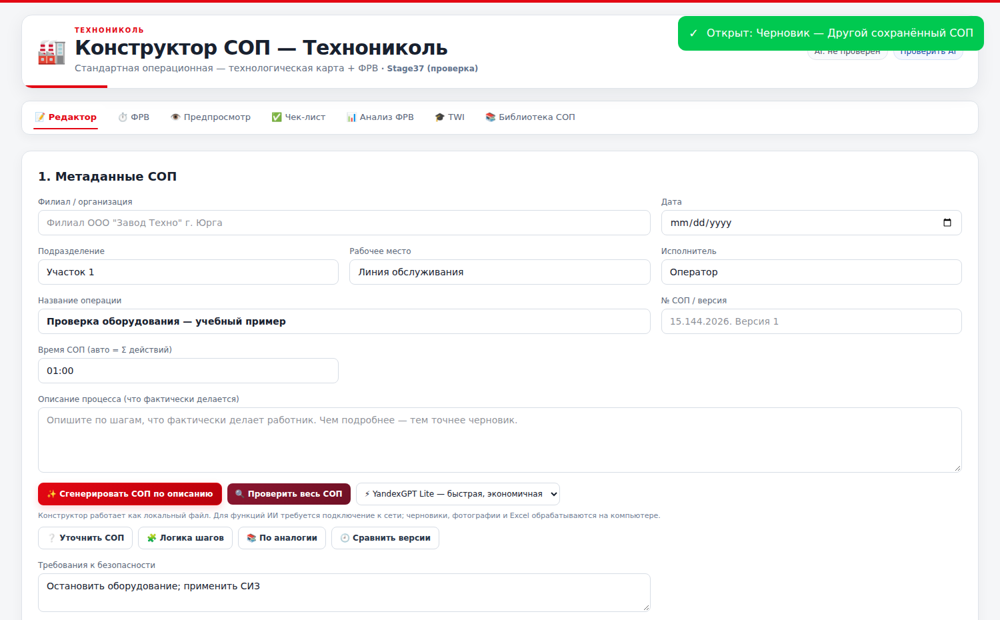
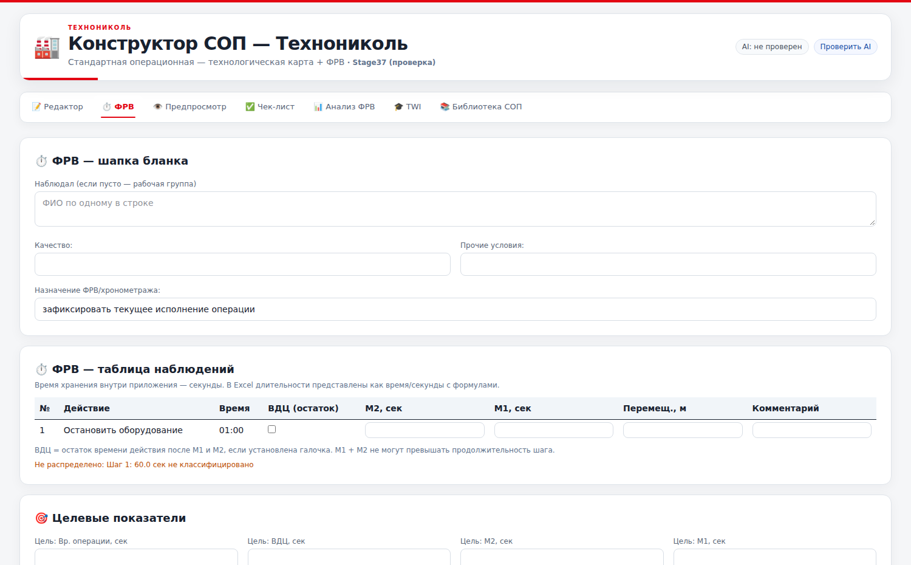
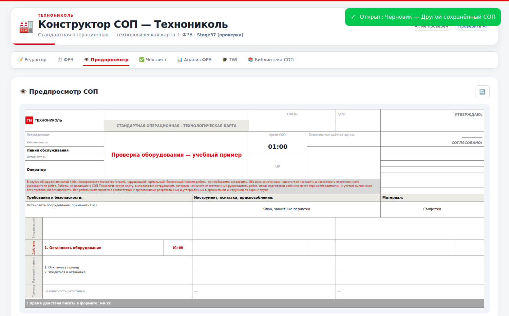
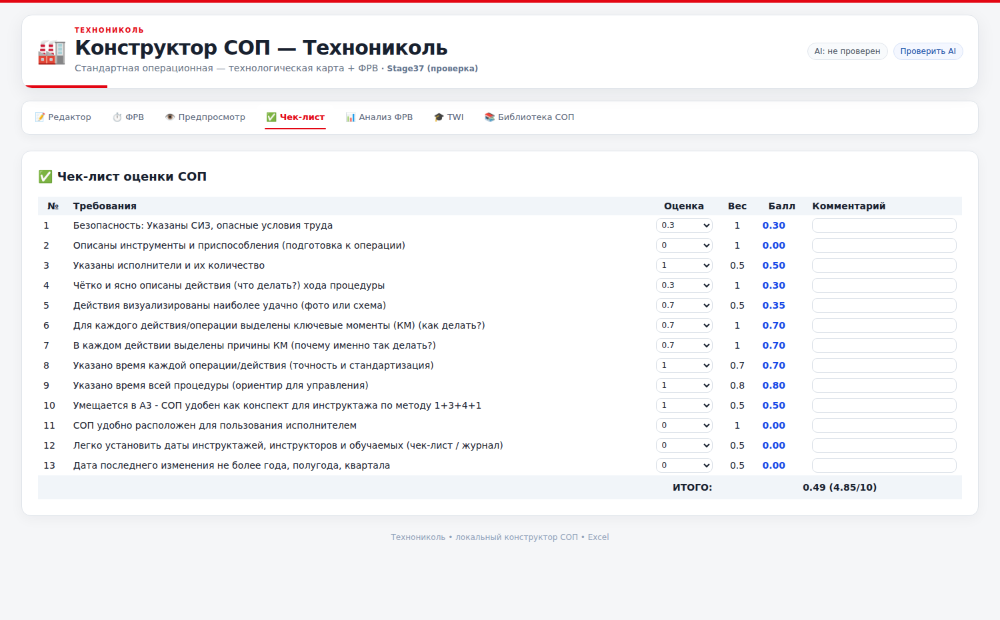
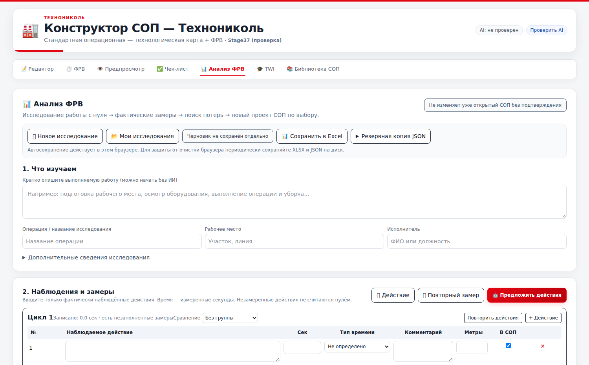
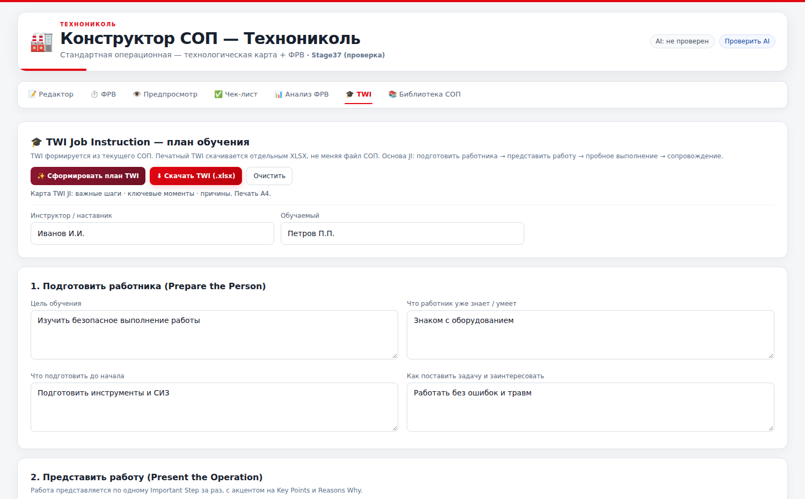
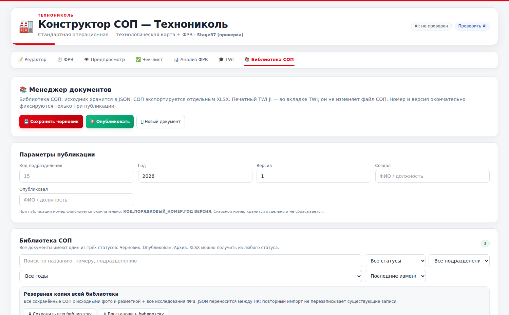

# Конструктор СОП — руководство пользователя (Stage37, настольная версия)

> **Актуальное руководство принятой Stage37** (23.11.2026, PR #33 объединён с `main`). Изображения ниже — настоящие скриншоты автономной программы в Chrome, созданные с учебным примером без производственных данных и без вызовов ИИ. Физическая печать и корпоративный сетевой диск проверяются отдельно.

## 1. Запуск, версия и сохранность данных

1. Скачайте автономный HTML `stage37-desktop-audit-browser-candidate.html`, откройте его в актуальном **Chrome** или **Edge**. Отдельная установка и веб-сервер не требуются. В шапке рядом с описанием есть пометка **Stage37 (проверка)** — она помогает отличать файл от старых копий в папке «Загрузки».
2. Черновики и фотографии хранятся в локальном хранилище браузера. **Автосохранение не является переносимой резервной копией.** При запуске по другому адресу `file://`, в другом браузере или на другом ПК данные могут быть в другом хранилище.
3. Если сверху появился баннер **«Найден несохранённый черновик»**, сначала выберите **«Восстановить»** или сознательно откажитесь от прежней версии. До выбора Stage37 не переписывает найденный черновик пустыми данными; отказ требует подтверждения. Если старый JSON повреждён, можно скачать его исходный текст прежде, чем удалить.
4. В разделе **«Библиотека СОП»** сначала нажмите **«Сохранить черновик»**, затем **«Сохранить всю библиотеку»**. Скачанный JSON включает сохранённые СОП, оригинальные фотографии/разметку и отдельные исследования ФРВ. На другом ПК в нужной HTML-версии воспользуйтесь **«Восстановить библиотеку»**. Перед восстановлением выполняется проверка SHA-256; конфликтные документы восстанавливаются как копии без замены оригиналов.

**Важно:** несохранённый текущий СОП не включается в общий архив. Переход к другой работе по кнопке «Открыть» теперь предупреждает, если текущие СОП или TWI содержат несохранённые изменения.

## 2. Редактор СОП

В **«Редакторе»** укажите филиал/организацию, дату, подразделение, рабочее место, исполнителя, название операции, описание процесса, требования безопасности, инструменты, материалы и ответственных. Добавьте шаги вручную или используйте **«Сгенерировать СОП по описанию»**, затем обязательно проверьте предложения ИИ. Кнопка **«Проверить весь СОП»** объединяет проверку в существующем блоке, без дополнительных вкладок.

Для каждого шага определите действие, ключевые моменты, причины, длительность, критерии выполнения и при необходимости снимок. Фоторедактор помогает разметить рисунки; исходное изображение хранится отдельно от результата с разметкой. Кнопка **«Скачать СОП (.xlsx)»** создаёт печатный Excel с тремя листами: СОП, ФРВ и чек-лист. Время СОП суммируется из длительностей шагов.

ИИ работает через предусмотренный прокси Yandex только при доступе к сети. **ИИ-предложения не являются автоматически утверждёнными производственными нормативами.**

## 3. ФРВ внутри СОП

Раздел **«ФРВ»** относится к текущему СОП. Здесь оформляются сведения наблюдателя, условия, наблюдения по шагам и целевые показатели (время операции, ВДЦ, М1, М2, перемещения, площадь и запасы). Внутри приложения длительности хранятся в секундах, а в Excel преобразуются в поля бланка с нужным форматированием.

Не смешивайте его с самостоятельным **«Анализом ФРВ»**: это два разных сценария работы. Если показатели М1/М2 противоречат длительности шага, экспорт СОП должен предложить проверку, а не молча исправлять измерения.

## 4. Предпросмотр и чек-лист

Во вкладке **«Предпросмотр»** отображаются текущие данные СОП и ФРВ до скачивания Excel. Проверяйте названия шагов, безопасность, фото, длительности и расположение информации.

Во вкладке **«Чек-лист»** выполняйте проверку заполнения и готовности к согласованию. Это не замена производственной проверки ответственным сотрудником.

## 5. Самостоятельный «Анализ ФРВ»

Вкладка **«Анализ ФРВ»** позволяет начать исследование независимо от текущего СОП. Укажите операцию и рабочее место, добавьте фактические действия, измеренные секунды и при необходимости повторные циклы. Незамеренные действия **не считаются равными нулю**. Программа локально рассчитывает показатели и помогает анализировать потери; предложения ИИ требуют проверки.

Верхние кнопки **«Новое исследование»**, **«Мои исследования»**, **«Сохранить в Excel»** и раскрывающаяся **«Резервная копия JSON»** управляют самостоятельной библиотекой. Для переноса результатов в новый СОП сначала выберите действия, проверьте проектные шаги, после чего используйте **«Создать новый проект СОП»**. Исходный открытый СОП не должен заменяться без подтверждения.

При одновременном открытии исследования в двух вкладках Stage36 защищает от перезаписи чужих изменений: при конфликте доступна команда **«Сохранить правки отдельной копией»**.

## 6. TWI — Job Instruction

Сначала составьте шаги СОП с ключевыми моментами и причинами. Затем откройте вкладку **«TWI»** и нажмите **«Сформировать план TWI»**. План проходит четыре этапа: подготовить работника, представить работу, выполнить пробно, сопровождать. При повторном формировании ручные правки защищены сравнением предложений.

Для печати нажмите **«Скачать TWI (.xlsx)»**. Создаётся **отдельный файл**, не новый лист в СОП:
- **«Карта разбора работы»** — A4 альбомная, важные шаги (что), ключевые моменты (как) и причины (почему).
- **«План наставника»** — A4 книжная, четыре этапа обучения, инструктор/обучаемый, место для подписей.

В Excel проверьте предварительный просмотр, переносы текста и необходимость проверки документа перед фактическим инструктажем. Если источник неполон или TWI устарел, экспорт предупреждает и помечает файл проектом.

## 7. Библиотека СОП, версии и резервные копии

Используйте **«Сохранить черновик»** для фиксации текущего документа. После проверки полей, номера и согласований можно нажать **«Опубликовать»**. Опубликованный СОП защищён от прямого редактирования — для изменений создавайте **«Новую версию»**. Отдельный статус **«Архив»** предназначен для опубликованных, снятых с работы документов.

Доступны поиск по библиотеке, фильтры по статусу, подразделению и году, история документа, переносимый JSON с фото, экспорт XLSX, создание версий и резервная копия всей библиотеки. При обнаружении несохранённых изменений на переход к другому документу **«Отмена» возвращает в текущий СОП**, чтобы вы могли сохранить изменения.

Блок **«Папка хранения»** предназначен для выбранной локальной или сетевой папки, если браузер выдаёт разрешение. Проверка двух реальных ПК и корпоративного сетевого диска не входит в браузерные автотесты и проводится отдельно.

## 8. Рекомендуемый порядок работы

1. Заполните исходные данные и шаги СОП, добавьте фото, ключевые моменты, причины и требования безопасности.
2. Проверьте расчёты, ФРВ, чек-лист и результаты ИИ; не используйте непроверенные факты.
3. При необходимости сформируйте TWI из СОП и скачайте отдельный TWI XLSX.
4. Сохраните СОП в библиотеку, затем скачайте три листа СОП XLSX и распечатайте нужные формы.
5. Перед переходом к другому HTML, компьютеру или очисткой браузера скачайте **резервную копию всей библиотеки**.
6. После согласования опубликуйте документ. При изменениях используйте новую версию, сохраняя старую.

## 9. Ограничения и troubleshooting

- **Нет кнопки TWI XLSX?** Посмотрите версию под названием программы. Файл Stage34.1 и другие ранние копии не содержат этой функции.
- **Появилось предупреждение о несохранённых изменениях?** Нажмите «Отмена», вернитесь в библиотеку и сохраните черновик перед переходом.
- **Черновик не читается?** Скачайте исходный текст из предупреждения, не удаляйте данные сразу.
- **Не открылся старый проект после перехода к новому HTML?** Восстановите переносимый JSON из последней резервной копии; локальные хранилища разных `file://` путей могут не совпадать.
- **ИИ недоступен?** Проверьте сеть и подключение прокси. Создание СОП вручную, локальная работа с ФРВ и формирование XLSX из уже имеющихся данных не требуют обращения к ИИ.
- **Физическая печать / сетевая папка:** соответствие реальному принтеру, корпоративным шаблонам и синхронизации между двумя ПК требуют отдельной производственной проверки.

---

*Скриншоты являются автоматическими снимками настоящей программы в настольном Chrome с специально подготовленными учебными данными. Они не являются доказательством качества ответов внешнего ИИ, поведения реальных принтеров или сетевого диска.*
