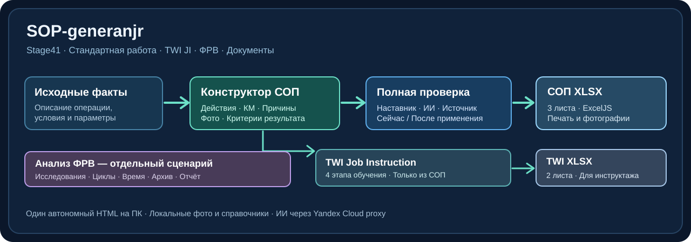
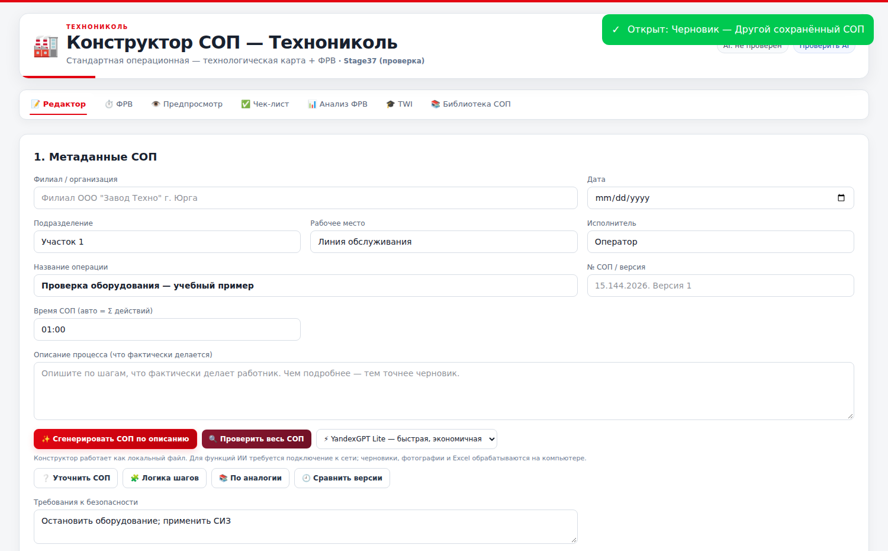
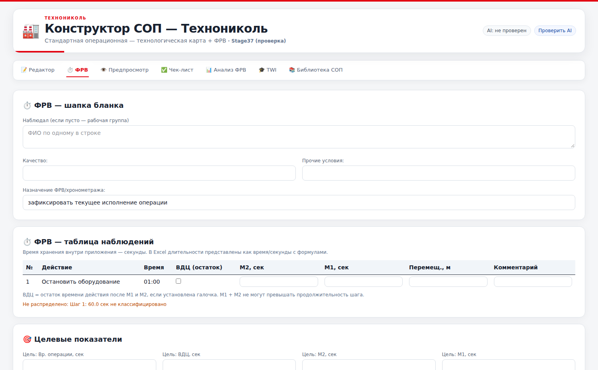
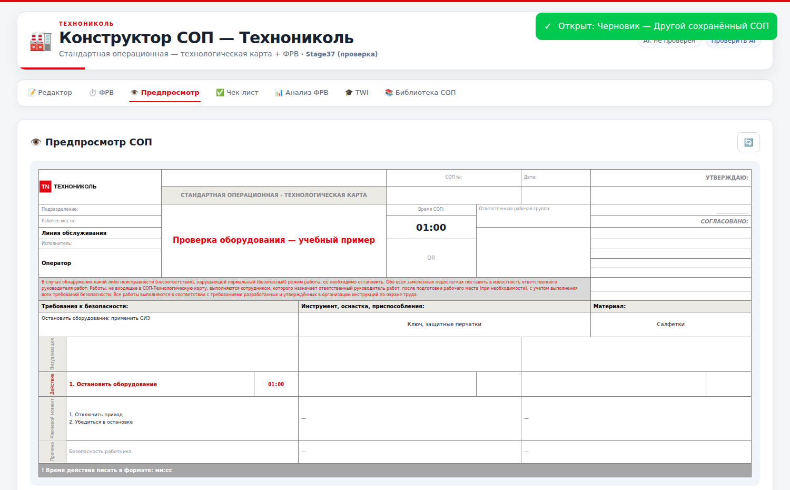
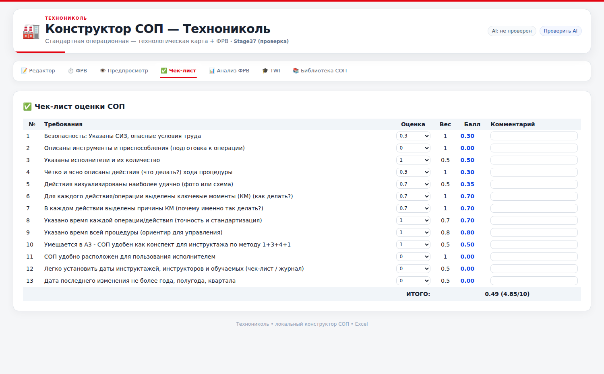
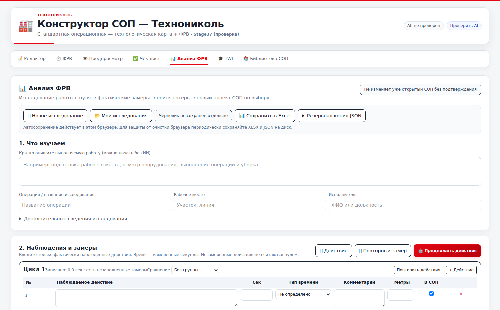
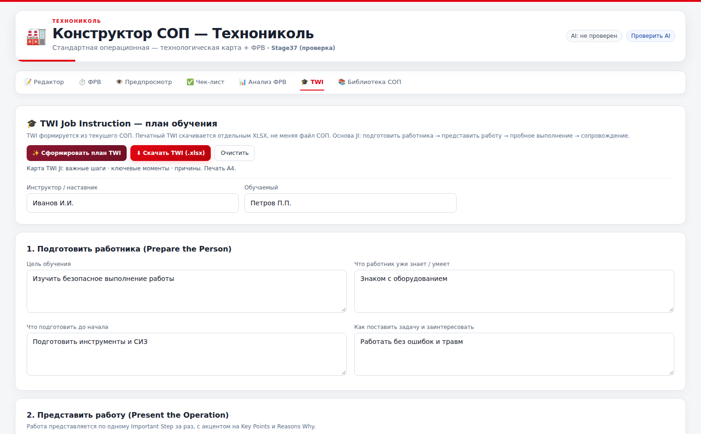
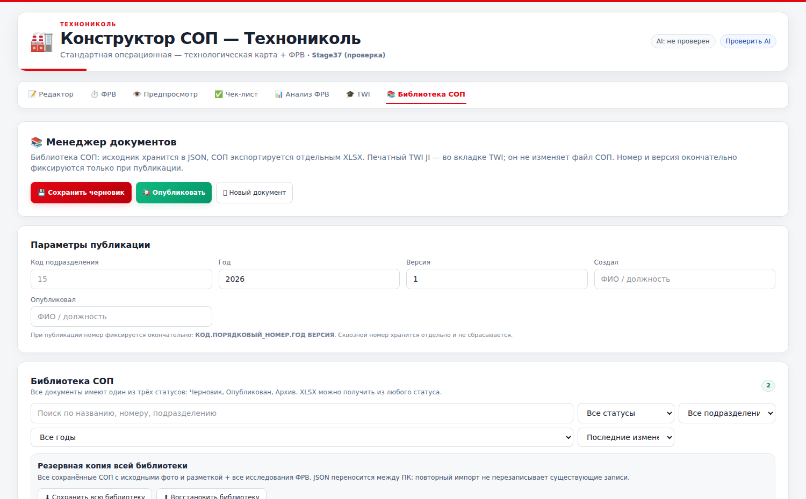

# Руководство пользователя — Конструктор СОП, Stage41

**Редакция:** 23 ноября 2026 года · **Версия:** принятая Stage41, `main`  
**Платформа:** ПК, Google Chrome / Microsoft Edge, автономный HTML (`file://`)  
**Для кого:** технолог, мастер, наставник, автор СОП, ответственный за ФРВ и проверку документов.

[← Главная README](../README.md) · [Скачать принятую Stage41](../releases/stage41-ai-quality-20261123.html) · [Руководство по аудиту L1](AUDIT_LEVEL1_USER_GUIDE_STAGE41_RU.md) · [Руководство по интерактивной карте](INTERACTIVE_MAP_USER_GUIDE_STAGE41_RU.md)

> **Об иллюстрациях.** Семь фотографий интерфейса ниже — настоящие автоматические скриншоты Chrome с учебным примером, созданные во время приёмки **Stage37**; это не макеты и не изображения реальных производственных документов. Основные разделы сохранены в Stage41, но отдельные кнопки и область ИИ-проверки в Stage39.1–Stage41 улучшались. Актуальные действия приведены текстом. Проверка качества YandexGPT, реальной печати и сети требует отдельной оценки.

## Содержание

1. [Назначение и возможности](#1-назначение-и-возможности)
2. [Запуск и сохранность данных](#2-запуск-и-сохранность-данных)
3. [Создание СОП вручную](#3-создание-соп-вручную)
4. [Генерация СОП с ИИ](#4-генерация-соп-с-ии)
5. [Причины WHY, нумерация и кнопка ✨](#5-причины-why-нумерация-и-кнопка-)
6. [Полная проверка СОП и наставник](#6-полная-проверка-соп-и-наставник)
7. [Фотографии и пиктограммы](#7-фотографии-и-пиктограммы)
8. [ФРВ внутри СОП](#8-фрв-внутри-соп)
9. [Предпросмотр и чек-лист](#9-предпросмотр-и-чек-лист)
10. [Самостоятельный анализ ФРВ](#10-самостоятельный-анализ-фрв)
11. [TWI Job Instruction из СОП](#11-twi-job-instruction-из-соп)
12. [Сохранение, публикация, архив и резервная копия](#12-сохранение-публикация-архив-и-резервная-копия)
13. [Печатные документы XLSX](#13-печатные-документы-xlsx)
14. [Рабочие сценарии и контроль перед выпуском](#14-рабочие-сценарии-и-контроль-перед-выпуском)
15. [Возможные проблемы](#15-возможные-проблемы)

## 1. Назначение и возможности

Программа объединяет подготовку **стандартизированной операционной процедуры (СОП)**, проверку технологической логики, **TWI Job Instruction**, ФРВ, фотографии, архив и выгрузку Excel. Приложение предназначено для **настольного браузера**: телефон и мобильная вёрстка не являются целью проекта.

Важно различать три документа / сценария:

| Объект | Для чего нужен | Откуда берутся данные |
|---|---|---|
| **СОП** | Описать порядок выполнения операции, критичные приёмы и требования к результату | Факты пользователя, шаги, при необходимости предложения ИИ |
| **TWI** | Обучать работника на основании утверждаемой процедуры | **Из существующего СОП**, с возможностью последующей ручной корректировки |
| **Самостоятельный Анализ ФРВ** | Зафиксировать наблюдения, замеры, циклы и оценить потери | Отдельное исследование; перенос предложений в новый СОП выполняется только по выбору пользователя |

**TWI не требует предварительного анализа ФРВ.** Excel используется как результат для печати или сохранения отчёта; фактические измерения ФРВ вводятся в программе.

## 2. Запуск и сохранность данных

1. Откройте [папку принятого релиза Stage41](../releases/stage41-ai-quality-20261123.html), скачайте HTML-файл на компьютер. Это **готовая программа**; файлы `src/`, Python и Node.js обычному пользователю не нужны.
2. Откройте скачанный файл в **Chrome или Edge**. Для редактора, картинок, ExcelJS и значков ISO не нужен локальный веб-сервер.
3. Убедитесь, что на экране отмечена версия **Stage41**. Если вместо неё показана более ранняя Stage, закрывайте старую копию и открывайте актуальный файл.
4. При обнаружении несохранённого черновика рассмотрите предложение **«Восстановить»**. Не удаляйте найденные данные, пока не проверили содержание и наличие резервной копии.
5. До первой серьёзной работы запланируйте сохранение документа в библиотеку и регулярную **JSON-копию всей библиотеки**.

**Ключевое ограничение:** IndexedDB/localStorage принадлежит конкретному окружению браузера. Запуск другого пути `file://`, другого профиля или другого ПК может показывать другой набор черновиков. **Никогда не считайте, что перенос одного HTML автоматически переносит СОП и фотографии.**

ИИ требует доступа к уже настроенному **Yandex Cloud Functions proxy**. Без доступного прокси можно работать вручную и формировать локальные XLSX по имеющимся данным.

## 3. Создание СОП вручную

Вкладка **«Редактор»** — основная рабочая область. Укажите в верхних полях название операции, подразделение/рабочее место, исполнителя, описание процесса, инструменты, материалы, условия и требования безопасности, если они известны и применимы.

### 3.1. Заполнение шага

Создавайте **Important Step** как один понятный законченный этап работы. Для каждого шага заполните:

| Поле | Что записывать | Чего избегать |
|---|---|---|
| **Действие (Important Step / Что)** | Конкретное действие с объектом | «Соблюдать безопасность» вместо операции |
| **Ключевые моменты (Key Points / Как)** | Только критичные детали приёма, влияющие на безопасность, качество, риск повреждения или результат | Формального требования заполнить три КМ, копирования действия |
| **Причина (Reason Why / Почему важно)** | Почему конкретный КМ важен по подтверждённым фактам | Повтора КМ с фразой «для обеспечения качества»; выдуманных последствий |
| **Длительность** | Фактически измеренное или обоснованное время, если оно известно | Придуманных секунд, температуры, количества оборотов |
| **Критерий результата** | Наблюдаемый признак правильного завершения | Размытых формулировок без проверяемого результата |
| **При необходимости: отклонения и фото** | Действия при известном отклонении, признаки, подтверждающий снимок | Неподтверждённых инструкций по оборудованию |

Количество КМ **может быть нулевым**: обычное действие само по себе не обязано содержать особый критичный приём. Аналогично причина не должна появляться просто «ради заполнения» без известного технологического основания.

В редакторе доступны операции управления шагами: **перестановка, копирование, сворачивание и восстановление последних изменений управления шагами** (введены в Stage39). При изменении очередности проверьте последовательность и время. Не предполагайте, что восстановление порядка шагов заменяет откат всех ручных правок текста.

### 3.2. Учебный пример структуры

Пример нужен **только для понимания полей**, а не как готовая заводская инструкция:

> **Действие:** Осмотреть корпус инструмента перед началом работы.  
> **КМ:** Обратить внимание на видимые трещины и сколы.  
> **Причина:** Выявить видимые повреждения до использования инструмента.  
> **Критерий:** Результат осмотра понятен исполнителю; дальнейшее решение принимается по действующей инструкции предприятия.

Если для оборудования нужны специальные критерии, числа или допуски, их должен предоставить ответственный инженер.

## 4. Генерация СОП с ИИ

1. В **«Редакторе»** введите максимально конкретное **описание процесса**: действия в фактическом порядке, объект, материал, используемые инструменты, реально известные параметры, проверяемый результат.
2. Нажмите **«Сгенерировать СОП по описанию»**.
3. Ознакомьтесь с проектом: ИИ создаёт шаги, ключевые моменты, причины и критерии по исходным данным. Для нехватки сведений могут появиться **вопросы на уточнение**.
4. Если в редакторе уже есть шаги, программа предусматривает отдельный выбор **отменить / добавить / заменить** с просмотром предложения. Не выбирайте замену, пока не сохранили ценную ручную работу.
5. Пройдите по каждому шагу и подтвердите технологический смысл. Только после этого переходите к полной проверке и экспорту.

### Как Stage41 влияет на генерацию

Stage41 добавляет модели проверку логической цепочки **Действие → КМ → Почему важно → Критерий результата**. Для одной общей причины не навязывается нумерация; при разных причинах допустимы несколько строк. Недостаток фактов должен приводить к вопросу, а не к догадке. **Это улучшение запроса, не доказательство правильности любого ответа ИИ** — инженерная проверка остаётся обязательной.

При сомнительном ответе исправьте исходное описание и повторите генерацию или правьте шаг вручную. Не включайте выдуманные нормы, параметры или предположения о рисках в утверждённый документ.

## 5. Причины WHY, нумерация и кнопка ✨

В корпоративском шаблоне **ровно одно поле «Причина» на шаг**. Внутри него можно хранить как одну общую причину, так и несколько нумерованных:

**Одна причина:**

> Позволяет обнаружить видимые повреждения до начала использования.

**Несколько разных причин внутри того же поля:**

> 1. Позволяет выявить повреждение кабеля.  
> 2. Позволяет заметить видимые нарушения корпуса.

Нумерация — часть текста **единственного поля**, а не дополнительные столбцы Excel. В печатном XLSX причины остаются в своей ячейке и выравниваются влево.

### Как пользоваться ✨ «Причина»

1. Введите существующую причину или черновик, который хотите улучшить.
2. Нажмите **✨** рядом с полем причины.
3. Программа отправит контекст действия и КМ в YandexGPT через существующий прокси.
4. **Если ответ проходит локальные проверки, он сразу заменит текст причины.** Отдельного окна «Было → Стало» и кнопки «Убрать повтор КМ» больше **нет**.
5. Оцените новый текст технологически. Если он неудачен, исправьте вручную или повторно нажмите ✨.

Проверки защищают от служебных ответов `null`/`keep`, неверной нумерации, неподтверждённых значений, некоторых выдуманных последствий и прямого повторения КМ. При неудаче может выполняться **один ограниченный повторный запрос**. Если оба ответа неприемлемы — прежняя причина сохраняется.

**Важно:** у этой ✨-кнопки запись **прямая**. В полной проверке СОП всё иначе — у предложенного исправления остаётся кнопка **«Применить»**.

## 6. Полная проверка СОП и наставник

Полная проверка — часть **существующего блока**, а не отдельная дублирующая панель.

1. Заполните СОП и нажмите **«Проверить весь СОП»** / действие полной проверки в редакторе.
2. Просмотрите замечания: отсутствие фактов, логические противоречия, вопросы к технологу, возможные улучшения.
3. Для применимого исправления Stage40 показывает **«Сейчас» / «После применения»** непосредственно в карточке замечания.
4. Сравните текст и нажмите прежнюю кнопку **«Применить»**, только если предложение корректно.
5. Если замечание спорное, используйте предусмотренные действия **обсуждения/оспаривания или откладывания**. Отдельный комментарий и основание полезнее бездумного применения.
6. Если вы вручную изменили СОП после проверки, устаревшее предложение **не должно перезаписать новые данные**; проведите повторную проверку.

**Что улучшено в Stage41:** из системной инструкции проверки удалён общий перечень нормативов, который мог провоцировать выдуманные ссылки. Программа также убирает **только точные дубли** подтверждённых ИИ-исправлений, не объединяя различные вопросы и разные варианты правок.

Две важные категории замечаний:

- **Подтверждённое:** найден дословный фрагмент текущего поля СОП — можно анализировать конкретное предлагаемое исправление.
- **Вопрос / гипотеза:** данных недостаточно — нужно выяснить факт у инженера, а не утверждать вымышленную причину или норму.

Эта проверка помогает редактору, но **не заменяет оценку технолога, охраны труда и утверждающих лиц**.

## 7. Фотографии и пиктограммы

Добавьте фотографию к соответствующему шагу. Встроенный редактор позволяет размечать изображение, масштабировать его и управлять историей разметки. Старайтесь показывать именно критичный приём или критерий результата; фотография не обязательна для каждого шага.

Знаки **ISO 7010 хранятся внутри HTML**, поэтому после скачивания работающих ресурсов отдельная загрузка изображений из внешней сети не требуется.

При экспорте Excel проверьте, что фотография находится у нужного шага и не обрезана. Проверенные файлы Stage32/37–41 содержат защиту наличия изображения и растяжения в область печатной ячейки, но конкретный физический принтер проверяется отдельно.

## 8. ФРВ внутри СОП

Вкладка **«ФРВ»** относится к **текущему СОП**. Здесь доступны сведения о наблюдении, времени, длительности шагов, ВДЦ, М1, М2, перемещениях и иных полях принятого корпоративного шаблона.

Сведения о времени нельзя угадывать. Если, например, введённые М1+М2 противоречат длительности шага, приложение предлагает исправить значения либо отдельно подтвердить выпуск помеченного отчёта; **исходные наблюдения не должны молча изменяться**.

Временные значения хранятся внутри программы в секундах; в XLSX они оформляются по корпоративскому шаблону.

## 9. Предпросмотр и чек-лист

В **«Предпросмотре»** проверьте целостность СОП: порядок шагов, КМ, причины, время, фотографии и формулировки.

Во вкладке **«Чек-лист»** проверьте заполнение обязательных сведений и готовность перед согласованием. Чек-лист — это вспомогательная внутренняя проверка, а не само утверждение процедуры предприятием.

## 10. Самостоятельный анализ ФРВ

Этот раздел **не равен вкладке «ФРВ» текущего СОП** и может использоваться до создания процедуры.

1. Откройте **«Анализ ФРВ»** и создайте новое исследование.
2. Запишите название операции, рабочее место и наблюдаемые действия.
3. Введите **фактически замеренные** значения времени по строкам; при необходимости создайте повторные циклы.
4. Просмотрите классификацию действий, потери, аналитику и предложения ИИ. Предложение ИИ не является измерением.
5. Сохраните исследование в библиотеке и при необходимости выгрузите **Excel-отчёт** либо переносимую **JSON-копию**.
6. Если хотите продолжить работу в конструкторе, используйте **«Создать новый проект СОП»** после выбора и проверки переносимых действий. Старый СОП не должен незаметно перезаписываться.

Отсутствие измерения **не равно нулю**. Видеоанализ, импорт чужих Excel-замеров и кнопочный хронометраж в текущем сценарии **не предусмотрены**.

## 11. TWI Job Instruction из СОП

TWI Job Instruction нужен для обучения исполнителя **уже описанной операции**. Не создавайте в нём независимую технологию.

1. Сначала заполните и проверьте **СОП**: действия, КМ, причины и критерии.
2. Перейдите на вкладку **«TWI»**.
3. Нажмите **«Сформировать план TWI»**. ИИ использует текущий СОП как источник.
4. Проверьте четырёхэтапный план:
   - **Prepare the Person** — подготовить работника.
   - **Present the Operation** — показать последовательность и объяснить КМ/WHY.
   - **Try Out Performance** — дать выполнить и объяснить работу.
   - **Follow Up** — сопровождать первые самостоятельные действия.
5. При необходимости внесите ручные уточнения. Если после генерации поменяли СОП, проверьте актуальность созданного TWI; при повторной генерации действуют механизмы защиты ручных правок.
6. Нажмите **«Скачать TWI (.xlsx)»** и проверьте печатную форму.

**Файл TWI XLSX — отдельный от СОП** и содержит **два листа**: «Карта разбора работы» (What / How / Why) и «План наставника» (четыре этапа обучения). В Stage41 улучшены инструкции модели: она не должна добавлять факты и режимы, отсутствующие в СОП.

## 12. Сохранение, публикация, архив и резервная копия

Используйте раздел **«Библиотека СОП»**:

- **«Сохранить черновик»** — зафиксировать рабочий документ.
- **«Опубликовать»** — использовать только после фактической внутренней проверки и согласования по правилам предприятия.
- **«Новая версия»** — изменять опубликованный документ без прямой перезаписи утверждённой версии.
- **«Архив»** — хранить документы, выведенные из активной работы.
- **«Сохранить всю библиотеку» / восстановление библиотеки** — перенести документы, фотографии и исследования ФРВ через JSON; при восстановлении предусмотрены проверки целостности и сохранение конфликтующих записей как копий.

**Безопасный порядок перед переносом на другой ПК:** сохранить текущий черновик → сохранить библиотеку в JSON → сохранить резервную копию отдельно → на другом ПК открыть нужный HTML и восстановить библиотеку → проверить документы и фотографии.

Если при открытии другого СОП появляется предупреждение о несохранённых изменениях — выберите отмену, сохраните свою работу, затем повторите переход. При ошибке восстановленного JSON сначала сохраните исходный файл для разбора.

Возможность выбрать локальную или корпоративскую сетевую папку зависит от разрешений браузера. **Совместная эксплуатация на двух физических ПК не подтверждена** только автоматическими тестами.

## 13. Печатные документы XLSX

| Файл | Количество листов | Назначение |
|---|---:|---|
| **СОП XLSX** | **3** | Корпоративская форма СОП, ФРВ и чек-лист |
| **TWI XLSX** | **2** | Карта разбора работы и план наставника |

Оба файла создаёт встроенная **ExcelJS**. Не нужно скачивать библиотеку ExcelJS отдельно. Уточняйте наличие фото, корректность переноса строк и расположение причин — особенно нумерованных строк в **одной** ячейке.

Проверки Linux/Windows и Chrome подтвердили форматирование/экспорт в тестовых сценариях. **Реальную печать** конкретным принтером и соответствие локально утверждённому корпоративскому бланку следует проверять на рабочем месте.

## 14. Рабочие сценарии и контроль перед выпуском

### Сценарий А. СОП с ИИ

1. Описание → **генерация СОП**.
2. Ручная проверка Action / КМ / WHY / критериев и фотографии.
3. **Полная проверка** → разбор замечаний → безопасное применение точечных исправлений.
4. **Предпросмотр** и **чек-лист**.
5. Сохранение черновика → **СОП XLSX** → согласование → публикация по правилам предприятия.
6. При необходимости **TWI из того же СОП**, затем отдельный TWI XLSX.

### Сценарий Б. ФРВ до составления СОП

1. **Анализ ФРВ** → измеренные секунды/циклы → локальная аналитика.
2. Сохранение исследования → выбор фактов для переноса.
3. **Создать новый проект СОП** → проверить перенесённые данные.
4. Доработать СОП в редакторе; TWI при необходимости сформировать **после** него.

### Контрольный перечень ответственного

- [ ] Все действия соответствуют фактической последовательности.
- [ ] КМ действительно критичны; нет искусственных трёх КМ.
- [ ] WHY содержит обоснование, а не повторяет действие.
- [ ] Числа, нормы, инструменты и опасности подтверждены исходными данными.
- [ ] Длительности и ФРВ проверены; незамеренные данные не превращены в нули.
- [ ] Изображения и ISO-пиктограммы соответствуют операции.
- [ ] Замечания ИИ рассмотрены специалистом; старые предложения не перезаписали новые правки.
- [ ] TWI совпадает с актуальным СОП.
- [ ] XLSX просмотрены перед печатью; черновик и JSON-копия сохранены.

## 15. Возможные проблемы

| Ситуация | Что делать |
|---|---|
| **Не видна функция из Stage41** | Проверьте подпись версии и откройте [актуальный HTML](../releases/stage41-ai-quality-20261123.html), а не старый файл из «Загрузок». |
| **ИИ не отвечает / ошибка JSON** | Проверьте соединение, доступность Yandex Cloud proxy и выбранную настройку модели. Не меняйте параметры прокси или реальные данные СОП ради обхода ошибки. |
| **ИИ вернул плохую причину** | Текст может быть отклонён автоматически; при успешной записи проверьте смысл, исправьте вручную или снова нажмите ✨. |
| **Отсутствует кнопка «Убрать повтор КМ»** | Это нормально: в Stage39.1 она намеренно удалена. |
| **Не показывается «Было → Стало» возле ✨ «Причина»** | Это нормально: причина применяется напрямую после проверки. **В полной проверке** сравнение есть внутри карточки замечания. |
| **Старое замечание не применяется** | СОП изменился с момента проверки. Выполните проверку повторно. |
| **После переноса HTML не видны документы** | Проверьте исходный браузер/путь и восстановите сохранённую JSON-копию библиотеки. |
| **Пропала фотография / ошибочный XLSX** | Проверьте загрузку исходного фото в библиотеке; экспорт не должен удалять исходные данные. Не очищайте черновик и резервную копию до выяснения причины. |
| **Не работает общая папка** | Проверьте разрешения Chrome/Edge и сетевой доступ. Реальный сценарий между двумя ПК требует отдельного испытания. |

---

## Дополнительные руководства

- **[Аудит первого уровня (L1) — как читать и проводить проверку](AUDIT_LEVEL1_USER_GUIDE_STAGE41_RU.md)** — анализ функций, доказательств и рисков.
- **[Единая интерактивная архитектурная карта Stage41 — как пользоваться](INTERACTIVE_MAP_USER_GUIDE_STAGE41_RU.md)** — четыре вкладки, фильтры, запросы ИИ, ссылки на код и 8 представлений LikeC4.
- [Обзорный результат аудита L1](AUDIT_LEVEL1_STAGE41_RU.md).
- [Техническое описание Stage41](STAGE41_AI_QUALITY_RU.md).
- [Файл передачи новому чату](START_NEW_CHAT_RU.md).

*Руководство описывает принятую Stage41; скриншоты являются исторически проверенными реальными снимками Stage37 с учебными данными. Документация не заменяет подтверждение технологических и охранных требований на конкретном производстве.*
